<div dir="rtl">

<p align="center">
  
</p>

<h1 align="center">iZiDatePicker</h1>

<p align="center">
  <b>تقویم ساده (ایزی) برای تاریخ شمسی و میلادی</b><br>
  بدون وابستگی · راست‌به‌چپ · دسترس‌پذیر · آگاه از تعطیلات · روی هر پروژه‌ای
</p>

<p align="center">
  <a href="https://www.npmjs.com/package/izi-datepicker"></a>
  <a href="https://github.com/yasproject/iZiDatePicker/actions/workflows/ci.yml"></a>
  
  
  
  <a href="LICENSE"></a>
</p>

<p align="center">
  <a href="README.md">🌐 English</a> · <b>🇮🇷 فارسی</b> ·
  <a href="https://yasproject.github.io/iZiDatePicker/">🎮 دموی زنده</a> ·
  <a href="docs/README.md">📚 آموزش‌ها</a> ·
  <a href="docs/fa/09-api-reference.md">🧾 مرجع API</a> ·
  <a href="docs/fa/10-faq.md">❓ پرسش‌های متداول</a>
</p>

<p align="center">
  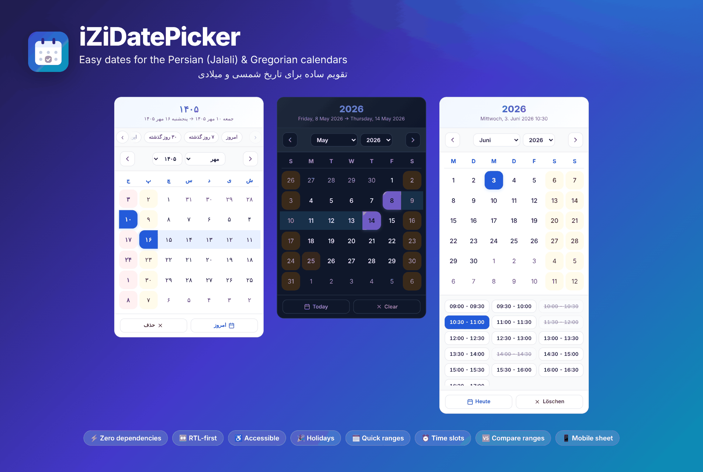
</p>

---

## ✨ چرا iZiDatePicker؟

| | |
|---|---|
| 🗓️ **دو تقویم، یک API** | شمسی (جلالی) و میلادی؛ حتی در یک صفحه. نام ماه و روز، ارقام و جهت برای **هر زبانی** از خود مرورگر (`Intl`). |
| ⚡ **واقعاً بدون وابستگی** | یک فایل JS و یک فایل CSS. بدون jQuery، بدون moment و بدون نیاز به ابزار ساخت. |
| ↔️ **اول راست‌به‌چپ** | برای راست‌به‌چپ ساخته شده و چپ‌به‌راست را هم به‌خوبی پوشش می‌دهد. |
| 🎉 **تعطیلات را می‌شناسد** | رنگ، راهنما، فهرست تعطیلات، فیلتر و خروجی ICS / CSV / JSON. منبع داده را خودتان تعیین می‌کنید. |
| 🗂️ **میانبرهای سریع** | «امروز»، «۷ روز گذشته»، «این ماه» ... ۲۳ مورد آماده یا هر چه خودتان بسازید. |
| ⏰ **ساعت و رزرو وقت** | فقط ساعت، بازهٔ ساعتی و شبکهٔ زمان‌های رزرو مثل صفحهٔ نوبت‌دهی پزشک. |
| 🆚 **مقایسهٔ دو بازه** | «این ماه در برابر ماه قبل» با یک کلیک. |
| ♿ **دسترس‌پذیر** | صفحه‌کلید، برچسب برای صفحه‌خوان، رنگ‌های مطابق WCAG AA. |
| 📱 **مناسب موبایل** | به‌صورت برگهٔ پایین باز می‌شود، با کشیدن ماه عوض می‌شود و هدف‌های لمسی بزرگ دارد. |
| 🧩 **با هر پروژه‌ای جور است** | `<script>` ساده، ESM، React، Vue، وب‌کامپوننت یا **بدون رابط** (UI خودتان). تایپ‌های TypeScript همراه است. |

## 🚀 شروع سریع (۳۰ ثانیه)

**۱. دو فایل را اضافه کنید**

```html
<link rel="stylesheet" href="izi-datepicker.css">
<script src="izi-datepicker.min.js"></script>
```

**۲. یک کادر متنی بگذارید و تقویم را راه بیندازید**

```html
<input id="date" placeholder="تاریخ را انتخاب کنید">
```

<!-- test -->
```js
const picker = new iZiDatePicker('#date', { calendar: 'gregorian', locale: 'en' });
```

تمام! اگر گزینه‌ای ندهید، تقویم شمسی می‌گیرید. با npm کار می‌کنید؟

```bash
npm install izi-datepicker
```
```js
import iZiDatePicker from 'izi-datepicker';
import 'izi-datepicker/css';
```

هر وقت خواستید تاریخ انتخاب‌شده را بخوانید:

<!-- test -->
```js
const p = new iZiDatePicker('#range', { value: '1405/03/07' });
p.getValue();             // "1405/03/07"
p.getValue('iso');        // "2026-05-28"
p.getValue('gregorian');  // "2026/05/28"
```

> 👉 راهنمای کامل در [**آموزش ۱ - شروع سریع**](docs/fa/01-getting-started.md) است.

## 🎬 ببینید چطور کار می‌کند

<p align="center">
  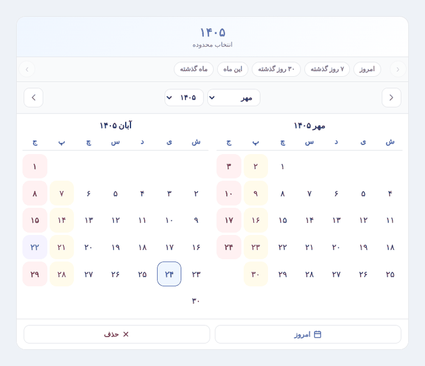<br>
  <sub>فشار بدهید، بکشید (حتی تا ماه بعد) و رها کنید تا بازه انتخاب شود.</sub>
</p>

## 🧰 معرفی قابلیت‌ها

### 🌍 دو تقویم، هر زبان

<p align="center">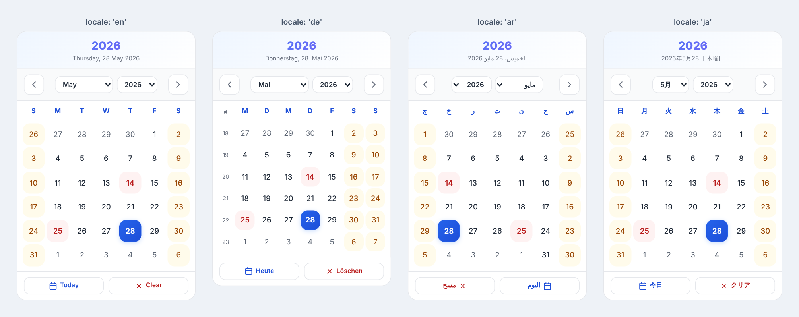</p>

<!-- test -->
```js
new iZiDatePicker('#date',  { calendar: 'gregorian', locale: 'de' });   // German, Monday first
new iZiDatePicker('#range', { calendar: 'jalali', locale: 'fa' });      // Persian
```

برای ترجمهٔ دکمه‌ها، بستهٔ زبان اختیاری `izi-datepicker.locales.js` را اضافه کنید (ar، de، es، fr، it، pt، ru، tr، zh، ja). ← [آموزش ۲](docs/fa/02-calendars-and-languages.md)

### 🗂️ بازه، میانبرها و انتخاب با کشیدن

<p align="center">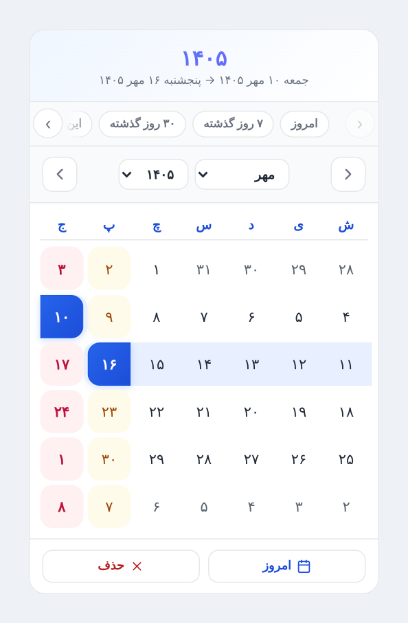 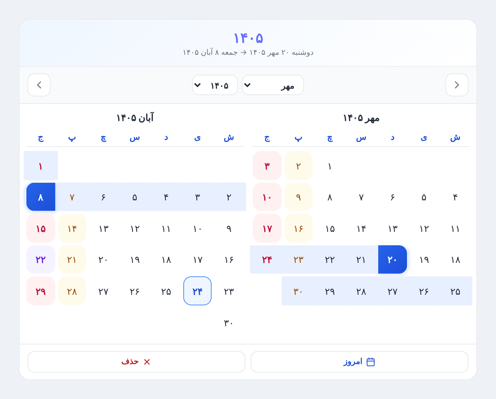</p>

<!-- test -->
```js
new iZiDatePicker('#range', { mode: 'range', months: 2, presets: 'default', minRangeDays: 2 });
```

حالت‌ها: `single` · `range` · `multiple` · `week` · `month` · `time` · `timerange`. ← [آموزش ۳](docs/fa/03-modes-ranges-presets.md)

### 🎉 تعطیلات، فهرست تعطیلات و خروجی

<p align="center">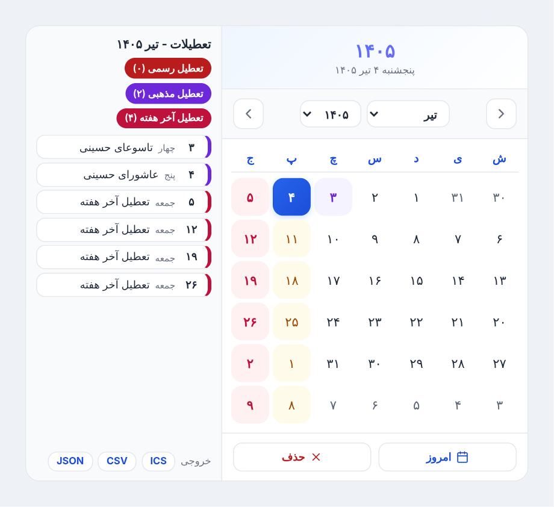</p>

<!-- test -->
```js
new iZiDatePicker('#date', {
  holidayList: { listScope: 'year', export: ['ics', 'csv'] },
  holidays: { sources: [{ type: 'url', url: '/holidays/{year}.json' }] }
});
```

روی یک تعطیلی در فهرست نگه دارید تا روزش در تقویم نمایش داده شود و کلیک کنید تا به آن بروید. ← [آموزش ۴](docs/fa/04-holidays.md)

> **دربارهٔ داده.** بدون پیکربندی، تعطیلات ثابتِ شمسی و جمعه‌ها را دارید. روزهای مذهبی (قمری) هر سال جابه‌جا می‌شوند و **حدس زده نمی‌شوند**؛ آن‌ها را از منبع خودتان بارگذاری می‌کنید. فهرست رسمی ایران برای **سال ۱۴۰۵** به‌صورت فایل `data/holidays/bundle.js` همراه است و تنها سالی است که تأیید شده.

### ⏰ ساعت و زمان‌های رزرو

<p align="center">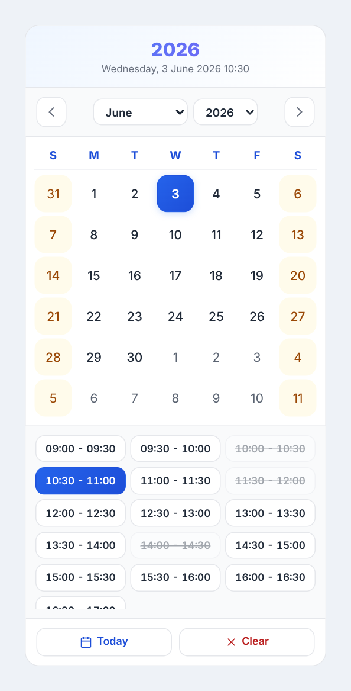 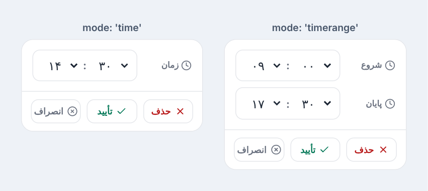</p>

<!-- test -->
```js
new iZiDatePicker('#booking', {
  calendar: 'gregorian', locale: 'en', timeFormat: '24h',
  timeSlots: { step: 30, duration: 30, min: '09:00', max: '17:00', disabled: ['10:00', '11:30'] }
});
```

← [آموزش ۵](docs/fa/05-time-and-booking.md)

### 🆚 مقایسهٔ دو بازه

<p align="center">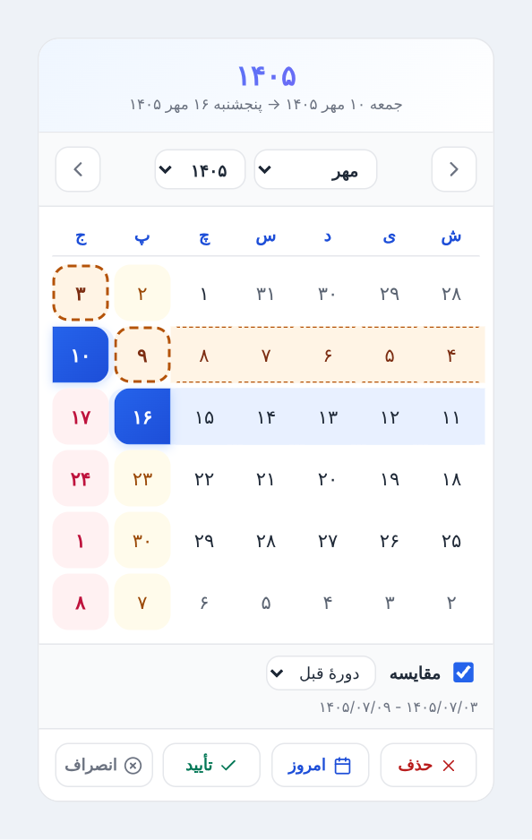</p>

<!-- test -->
```js
new iZiDatePicker('#range', { mode: 'range', compare: { enabled: true, mode: 'previousPeriod' } });
```

← [آموزش ۶](docs/fa/06-compare-ranges.md)

### 🎨 ظاهر را مال خودتان کنید

<p align="center">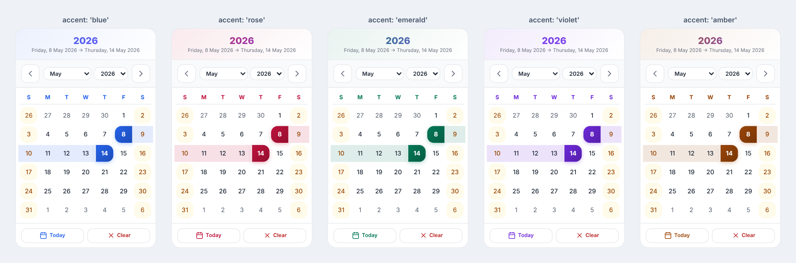</p>

<!-- test -->
```js
new iZiDatePicker('#date', { theme: 'dark', accent: 'violet', size: 'lg', cellShape: 'circle', radius: 'xl' });
```

با یک رنگ، همهٔ تقویم هم‌رنگ می‌شود. اندازه از `xs` تا `xl`، روشن / تاریک / خودکار، کلاس و متغیر CSS دلخواه. ← [آموزش ۷](docs/fa/07-styling-and-themes.md)

### 📱 ساخته‌شده برای گوشی

<p align="center">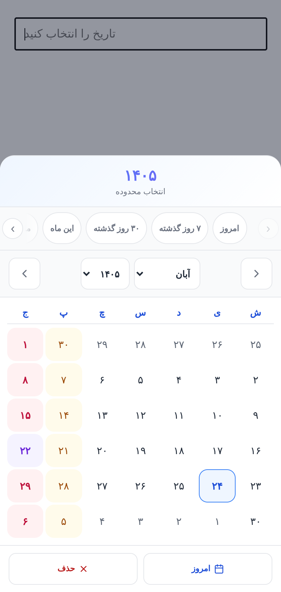</p>

روی صفحه‌های کوچک، تقویم به‌صورت برگهٔ پایین باز می‌شود: هدف‌های لمسی بزرگ، کشیدن برای تغییر ماه و بدون مزاحمت کیبورد صفحه.

### 🧩 فریم‌ورک شما

```jsx
import { IziDatePickerInput } from 'izi-datepicker/react';
<IziDatePickerInput value={text} onChange={(t) => setText(t)} options={{ mode: 'range' }} />
```
```html
<izi-datepicker name="from" mode="range" calendar="gregorian" locale="en"></izi-datepicker>
```
React، Vue 3، وب‌کامپوننت، TypeScript و حالت بدون رابط: ← [آموزش ۸](docs/fa/08-frameworks-and-advanced.md)

## 📚 قدم‌به‌قدم یاد بگیرید

| # | آموزش | چه چیزی یاد می‌گیرید |
|---|---|---|
| ۱ | [شروع سریع](docs/fa/01-getting-started.md) | نصب، اولین تقویم، خواندن مقدار، inline، `data-izi` |
| ۲ | [تقویم‌ها و زبان‌ها](docs/fa/02-calendars-and-languages.md) | شمسی / میلادی، زبان، ارقام، قالب، تبدیل |
| ۳ | [حالت‌ها، بازه‌ها و میانبرها](docs/fa/03-modes-ranges-presets.md) | همهٔ حالت‌ها، بستن تاریخ‌ها، قانون بازه، میانبر، کشیدن، صفحه‌کلید |
| ۴ | [تعطیلات](docs/fa/04-holidays.md) | منبع داده، بسته، پنل فهرست، خروجی |
| ۵ | [ساعت و رزرو وقت](docs/fa/05-time-and-booking.md) | انتخاب ساعت، بازهٔ ساعتی، زمان‌های رزرو |
| ۶ | [مقایسهٔ دو بازه](docs/fa/06-compare-ranges.md) | دورهٔ قبل / سال قبل / دلخواه |
| ۷ | [ظاهر، تم و موبایل](docs/fa/07-styling-and-themes.md) | اندازه، رنگ، CSS، رندر سفارشی، گوشی، دسترس‌پذیری |
| ۸ | [فریم‌ورک‌ها و موارد پیشرفته](docs/fa/08-frameworks-and-advanced.md) | React، Vue، وب‌کامپوننت، بدون رابط، SSR، TypeScript |
| ۹ | [مرجع API](docs/fa/09-api-reference.md) | همهٔ گزینه‌ها، متدها و رویدادها |
| ۱۰ | [پرسش‌های متداول](docs/fa/10-faq.md) | مشکلات رایج و پاسخ‌ها |

هر نمونه‌کدِ اجراشدنی در README و آموزش‌ها توسط تست‌های پروژه اجرا می‌شود، پس مثال‌ها درست می‌مانند.

## 🧾 چیت‌شیت

| می‌خواهم ... | گزینه |
|---|---|
| تقویم میلادی داشته باشم | `calendar: 'gregorian', locale: 'en'` |
| یک بازه انتخاب شود | `mode: 'range'` |
| چند ماه نمایش داده شود | `months: 2` |
| میانبر اضافه کنم | `presets: 'default'` |
| تاریخ‌ها را ببندم | `minDate`، `maxDate`، `disabledWeekdays`، `disabledDates`، `isDateDisabled` |
| تعطیلات را از سرورم بگیرم | `holidays: { sources: [{ type: 'url', url: '/h/{year}.json' }] }` |
| کاربر ساعت انتخاب کند | `timePicker: true` یا `mode: 'time'` |
| نوبت رزرو کنم | `timeSlots: { step: 30, duration: 30 }` |
| دو بازه را مقایسه کنم | `compare: true` |
| رنگ را عوض کنم | `accent: '#7c3aed'` |
| حالت تاریک | `theme: 'dark'` (یا `'auto'`) |
| تقویم همیشه دیده شود | `inline: true` |
| مقدار را بگیرم | `picker.getValue('iso')` / `picker.getRange()` |

## 🧪 کیفیت: چه چیزهایی واقعاً بررسی شده

* **بیش از ۸۶۰ بررسی خودکار عملکردی** (jsdom و یک مرورگر واقعی Chromium: چیدمان، موقعیت، لمس، انتخاب با کشیدن، دسترس‌پذیری با axe-core)، و **هر نمونه‌کد و لینک در همین مستندات** هم تست می‌شود.
* محاسبات تقویم شمسی با `jalaali-js` و تقویم فارسی خود مرورگر برای **تک‌تک روزهای ۱۳۰۰ تا ۱۵۰۰** یکسان است؛ محاسبات میلادی با موتور `Date` در جاوااسکریپت برای ۱۹۰۰ تا ۲۱۰۰.
* بسته از یک tarball واقعی در یک پروژهٔ تازه نصب و با CommonJS، ESM، TypeScript، React، Vue و عنصر سفارشی import شده است.

**هنوز بررسی نشده (کمک کنید!):** Firefox، Safari / iOS، دستگاه‌های واقعی، صفحه‌خوان‌ها (NVDA، VoiceOver)، wrapperهای React/Vue داخل یک برنامهٔ واقعی و ترجمه‌های ماشین‌کمکیِ ده زبان رابط. اگر می‌توانید هر کدام را تست کنید، لطفاً [یک issue باز کنید](https://github.com/yasproject/iZiDatePicker/issues/new/choose).

## 🌐 مرورگرهای پشتیبانی‌شده

Chrome / Edge، Firefox و Safari جدید (به `Intl.DateTimeFormat`، ویژگی‌های منطقی CSS و `color-mix()` نیاز دارد). فقط روی Chromium واقعاً تست شده، بالا را ببینید.

## 🛠️ توسعه

```bash
git clone https://github.com/yasproject/iZiDatePicker.git && cd iZiDatePicker
npm ci
npm run build        # ESM + نسخهٔ فشرده + sourcemap + بستهٔ زبان، با بررسی سقف حجم
npm test             # تست‌های jsdom
npm run test:browser # تست مرورگر واقعی (puppeteer)
npm run test:all     # تایپ‌ها + همه چیز
node tools/screenshots.mjs   # ساخت دوبارهٔ تصاویر این README
```

## 🤝 مشارکت

گزارش باگ، ترجمه، تست روی مرورگرهای دیگر و pull request همگی خوش‌آمدند: [CONTRIBUTING.md](CONTRIBUTING.md). لطفاً [منشور رفتار](CODE_OF_CONDUCT.md) را بخوانید. مسائل امنیتی: [SECURITY.md](SECURITY.md).

## 📄 مجوز

[MIT](LICENSE). تبدیل شمسی بر پایهٔ الگوریتم [jalaali-js](https://github.com/jalaali/jalaali-js) (MIT) است.

<p align="center"><sub>با ❤️ برای همهٔ کسانی که یک بار با یک انتخابگر تاریخ دست‌وپنجه نرم کرده‌اند. <b>iZi</b> = ایزی = ساده.</sub></p>

</div>
