<p align="center">
  
</p>

<h1 align="center">iZiDatePicker</h1>

<p align="center">
  <b>Easy dates for the Persian (Jalali) &amp; Gregorian calendars.</b><br>
  Zero dependencies · RTL-first · accessible · holiday-aware · works everywhere
</p>

<p align="center">
  <a href="https://www.npmjs.com/package/izi-datepicker"></a>
  <a href="https://github.com/yasproject/iZiDatePicker/actions/workflows/ci.yml"></a>
  
  
  
  <a href="LICENSE"></a>
</p>

<p align="center">
  <b>🌐 English</b> · <a href="README.fa.md">🇮🇷 فارسی</a> ·
  <a href="https://yasproject.github.io/iZiDatePicker/">🎮 Live demo</a> ·
  <a href="docs/README.md">📚 Guides</a> ·
  <a href="docs/en/09-api-reference.md">🧾 API</a> ·
  <a href="docs/en/10-faq.md">❓ FAQ</a>
</p>

<p align="center">
  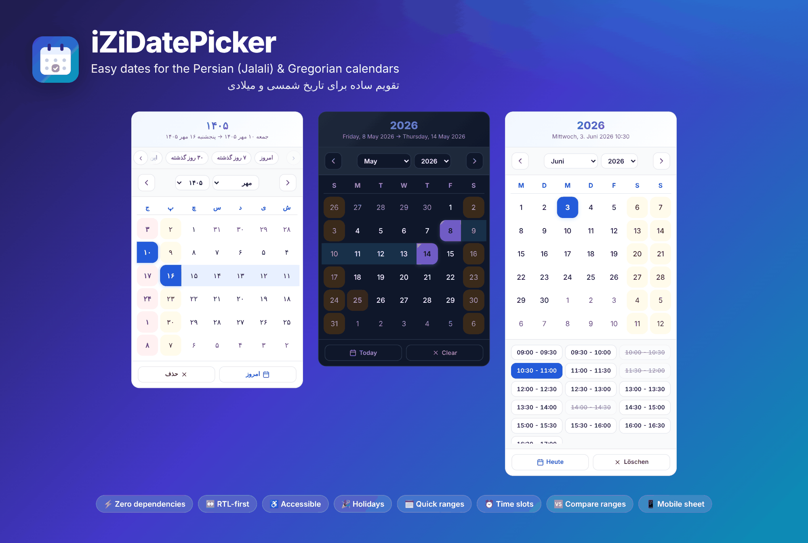
</p>

---

## ✨ Why iZiDatePicker?

| | |
|---|---|
| 🗓️ **Two calendars, one API** | Jalali (Persian) and Gregorian, even on the same page. Names, digits and direction for **any language** via the browser's `Intl`. |
| ⚡ **Truly zero dependencies** | One JS file + one CSS file. No jQuery, no moment, no build step needed. |
| ↔️ **RTL-first** | Built for right-to-left, and just as good left-to-right. |
| 🎉 **Knows about holidays** | Colours, tooltips, a holiday list, filters, and export to ICS / CSV / JSON. You decide where the data comes from. |
| 🗂️ **Quick ranges** | "Today", "Last 7 days", "This month"... 23 built in, or make your own. |
| ⏰ **Time and booking** | Time-only, time ranges, and a booking-slot grid like a doctor's appointment page. |
| 🆚 **Compare two ranges** | "This month vs last month" in one click. |
| ♿ **Accessible** | Keyboard, screen-reader labels, WCAG AA colours. |
| 📱 **Phone-friendly** | Opens as a bottom sheet, with swipe and big tap targets. |
| 🧩 **Fits your stack** | Plain `<script>`, ESM, React, Vue, a web component, or **headless** (bring your own UI). TypeScript types included. |

## 🚀 Quick start (30 seconds)

**1. Add two files**

```html
<link rel="stylesheet" href="izi-datepicker.css">
<script src="izi-datepicker.min.js"></script>
```

**2. Add a text box and start the picker**

```html
<input id="date" placeholder="Pick a date">
```

<!-- test -->
```js
const picker = new iZiDatePicker('#date', { calendar: 'gregorian', locale: 'en' });
```

That's it! Leave out the options and you get the Persian calendar. Using npm instead?

```bash
npm install izi-datepicker
```
```js
import iZiDatePicker from 'izi-datepicker';
import 'izi-datepicker/css';
```

Read the chosen date at any time:

<!-- test -->
```js
const p = new iZiDatePicker('#range', { value: '1405/03/07' });
p.getValue();             // "1405/03/07"
p.getValue('iso');        // "2026-05-28"
p.getValue('gregorian');  // "2026/05/28"
```

> 👉 The full walkthrough is in [**Guide 1 - Getting started**](docs/en/01-getting-started.md).

## 🎬 See it in action

<p align="center">
  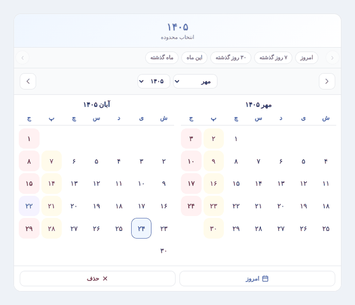<br>
  <sub>Press, drag (even into the next month) and release to select a range.</sub>
</p>

## 🧰 Feature tour

### 🌍 Two calendars, any language

<p align="center">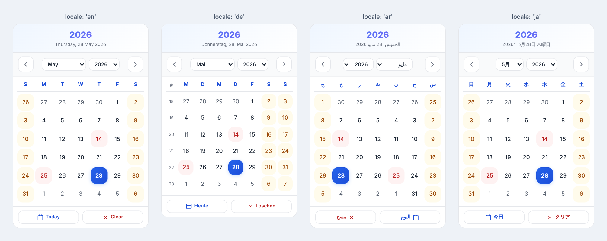</p>

<!-- test -->
```js
new iZiDatePicker('#date',  { calendar: 'gregorian', locale: 'de' });   // German, Monday first
new iZiDatePicker('#range', { calendar: 'jalali', locale: 'fa' });      // Persian
```
Add the optional language pack for the buttons: `izi-datepicker.locales.js` (ar, de, es, fr, it, pt, ru, tr, zh, ja). → [Guide 2](docs/en/02-calendars-and-languages.md)

### 🗂️ Ranges, quick ranges and drag-to-select

<p align="center">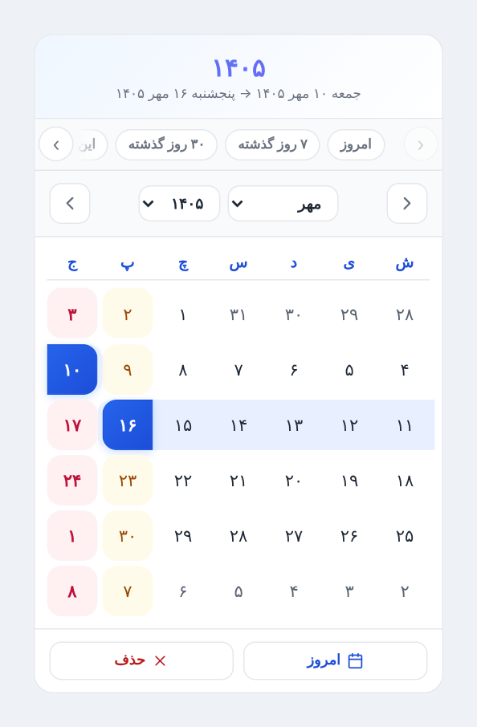 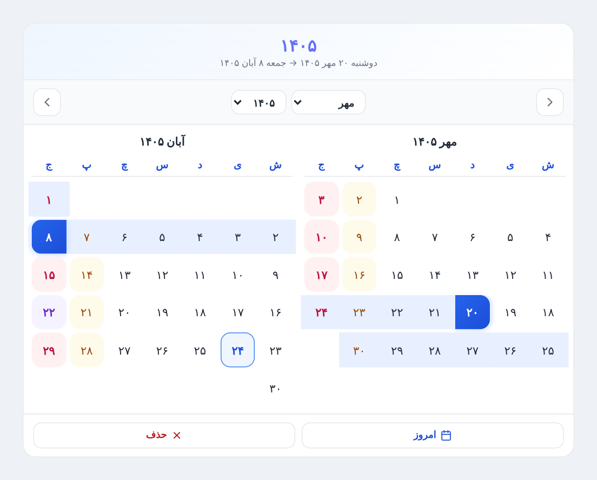</p>

<!-- test -->
```js
new iZiDatePicker('#range', { mode: 'range', months: 2, presets: 'default', minRangeDays: 2 });
```
Modes: `single` · `range` · `multiple` · `week` · `month` · `time` · `timerange`. → [Guide 3](docs/en/03-modes-ranges-presets.md)

### 🎉 Holidays, a holiday list and export

<p align="center">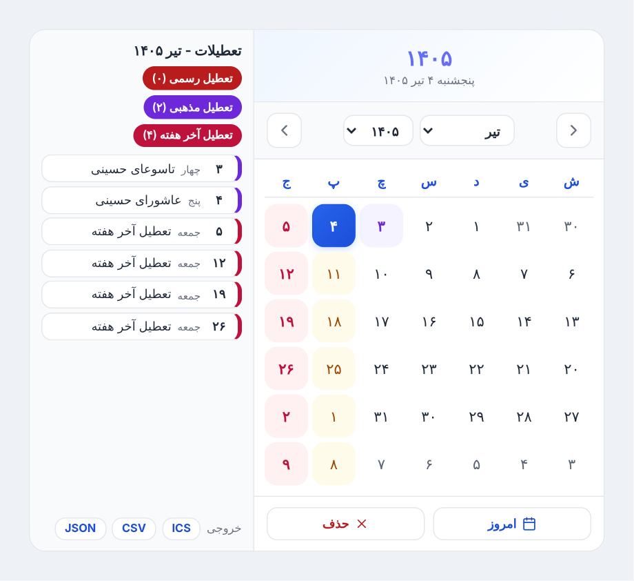</p>

<!-- test -->
```js
new iZiDatePicker('#date', {
  holidayList: { listScope: 'year', export: ['ics', 'csv'] },
  holidays: { sources: [{ type: 'url', url: '/holidays/{year}.json' }] }
});
```
Hover a holiday in the list to preview its day, click it to jump there. → [Guide 4](docs/en/04-holidays.md)

> **About the data.** Out of the box you get the fixed solar holidays of the Jalali calendar and Fridays. Religious (lunar) days change every year, so they are **not guessed**: you load them from your own source. The official Iranian list for **Jalali year 1405** is included as `data/holidays/bundle.js`; it is the only year that was verified.

### ⏰ Time and booking slots

<p align="center">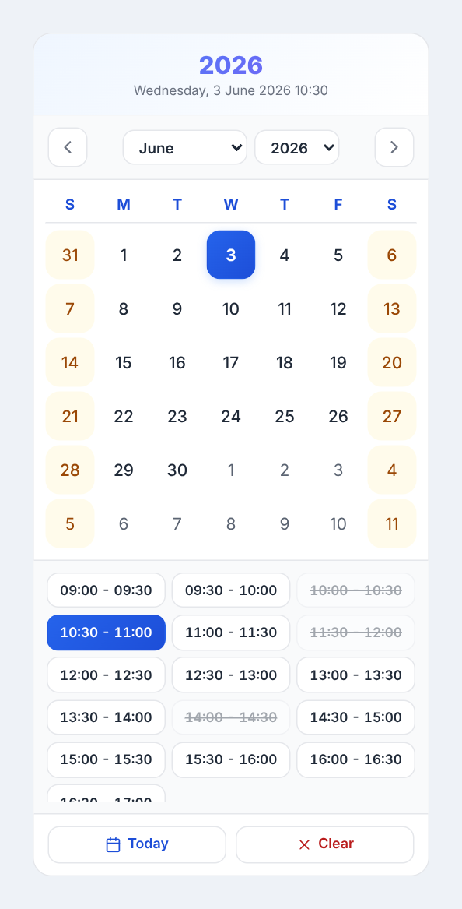 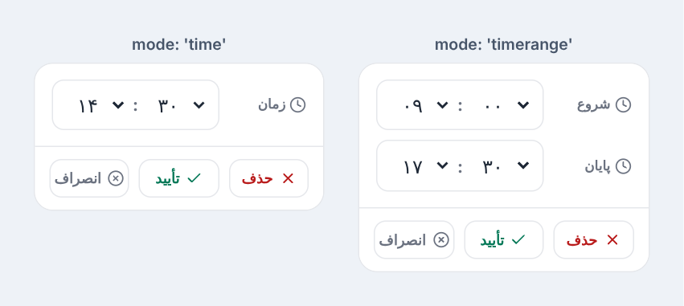</p>

<!-- test -->
```js
new iZiDatePicker('#booking', {
  calendar: 'gregorian', locale: 'en', timeFormat: '24h',
  timeSlots: { step: 30, duration: 30, min: '09:00', max: '17:00', disabled: ['10:00', '11:30'] }
});
```
→ [Guide 5](docs/en/05-time-and-booking.md)

### 🆚 Compare two ranges

<p align="center">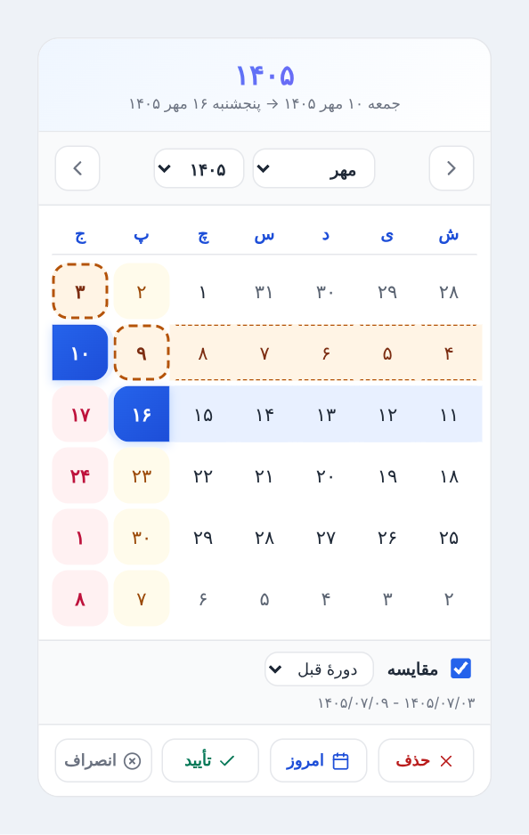</p>

<!-- test -->
```js
new iZiDatePicker('#range', { mode: 'range', compare: { enabled: true, mode: 'previousPeriod' } });
```
→ [Guide 6](docs/en/06-compare-ranges.md)

### 🎨 Make it yours

<p align="center">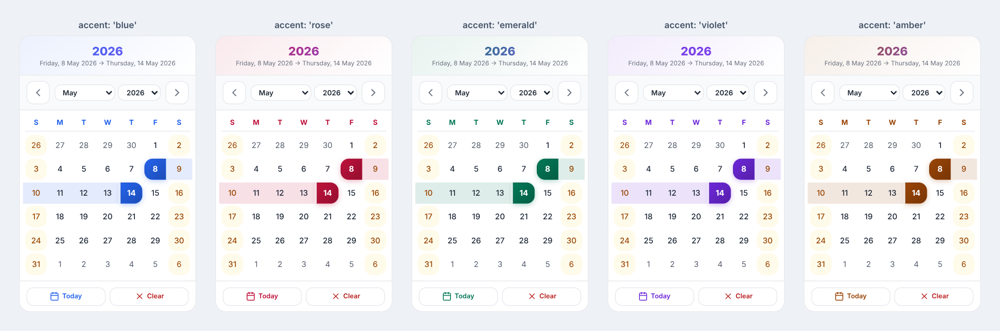</p>

<!-- test -->
```js
new iZiDatePicker('#date', { theme: 'dark', accent: 'violet', size: 'lg', cellShape: 'circle', radius: 'xl' });
```
One colour re-themes everything. Sizes from `xs` to `xl`, light / dark / auto, your own CSS classes and variables. → [Guide 7](docs/en/07-styling-and-themes.md)

### 📱 Made for phones

<p align="center">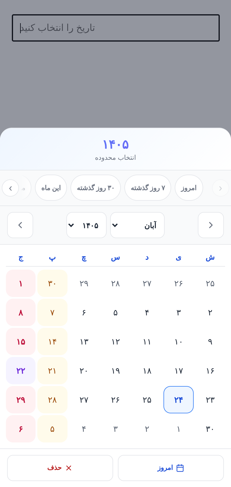</p>

On small screens the calendar opens as a bottom sheet with big tap targets, swipe to change month, and no on-screen keyboard in the way.

### 🧩 Your framework

```jsx
import { IziDatePickerInput } from 'izi-datepicker/react';
<IziDatePickerInput value={text} onChange={(t) => setText(t)} options={{ mode: 'range' }} />
```
```html
<izi-datepicker name="from" mode="range" calendar="gregorian" locale="en"></izi-datepicker>
```
React, Vue 3, a web component, TypeScript and a headless mode: → [Guide 8](docs/en/08-frameworks-and-advanced.md)

## 📚 Learn step by step

| # | Guide | You will learn |
|---|---|---|
| 1 | [Getting started](docs/en/01-getting-started.md) | install, first picker, reading values, inline, `data-izi` |
| 2 | [Calendars & languages](docs/en/02-calendars-and-languages.md) | Jalali / Gregorian, locales, digits, formats, converting |
| 3 | [Modes, ranges & quick ranges](docs/en/03-modes-ranges-presets.md) | all modes, blocking dates, range rules, presets, drag, keyboard |
| 4 | [Holidays](docs/en/04-holidays.md) | data sources, packs, the list panel, export |
| 5 | [Time & booking](docs/en/05-time-and-booking.md) | time pickers, time ranges, booking slots |
| 6 | [Compare two ranges](docs/en/06-compare-ranges.md) | previous period / year / custom |
| 7 | [Styling, themes & mobile](docs/en/07-styling-and-themes.md) | sizes, colours, CSS, render hooks, phones, accessibility |
| 8 | [Frameworks & advanced](docs/en/08-frameworks-and-advanced.md) | React, Vue, web component, headless, SSR, TypeScript |
| 9 | [API reference](docs/en/09-api-reference.md) | every option, method, event |
| 10 | [FAQ & troubleshooting](docs/en/10-faq.md) | common problems and answers |

Every runnable sample in the README and the guides is executed by the test-suite, so the examples stay correct.

## 🧾 Cheat sheet

| I want to... | Option |
|---|---|
| use the Gregorian calendar | `calendar: 'gregorian', locale: 'en'` |
| pick a range | `mode: 'range'` |
| show several months | `months: 2` |
| add quick ranges | `presets: 'default'` |
| block dates | `minDate`, `maxDate`, `disabledWeekdays`, `disabledDates`, `isDateDisabled` |
| show holidays from my server | `holidays: { sources: [{ type: 'url', url: '/h/{year}.json' }] }` |
| let users pick a time | `timePicker: true` or `mode: 'time'` |
| book appointments | `timeSlots: { step: 30, duration: 30 }` |
| compare two ranges | `compare: true` |
| change the colour | `accent: '#7c3aed'` |
| dark mode | `theme: 'dark'` (or `'auto'`) |
| always show the calendar | `inline: true` |
| get the value | `picker.getValue('iso')` / `picker.getRange()` |

## 🧪 Quality: what has really been checked

* **860+ automated functional checks** (jsdom, plus a real Chromium browser: layout, positioning, touch, drag-select, accessibility with axe-core), and **every code sample and link in these docs** is tested too.
* The Jalali arithmetic matches `jalaali-js` and the browser's own Persian calendar for **every day of 1300-1500**; the Gregorian arithmetic matches the JS `Date` engine for 1900-2100.
* The package was installed from a real tarball into a fresh project and imported through CommonJS, ESM, TypeScript, React, Vue and the custom element.

**Not verified yet (please help!):** Firefox, Safari / iOS, real devices, screen readers (NVDA, VoiceOver), the React/Vue wrappers inside a real app, and the machine-assisted translations of the ten interface languages. If you can test any of these, please [open an issue](https://github.com/yasproject/iZiDatePicker/issues/new/choose).

## 🌐 Browser support

Current Chrome / Edge, Firefox and Safari (needs `Intl.DateTimeFormat`, CSS logical properties and `color-mix()`). Tested for real on Chromium only, see above.

## 🛠️ Development

```bash
git clone https://github.com/yasproject/iZiDatePicker.git && cd iZiDatePicker
npm ci
npm run build        # ESM + minified + sourcemap + locale pack, enforces the size budget
npm test             # jsdom suites
npm run test:browser # real-browser suite (puppeteer)
npm run test:all     # types + everything
node tools/screenshots.mjs   # regenerate the pictures in this README
```

## 🤝 Contributing

Bug reports, translations, tests on other browsers and pull requests are all welcome: see [CONTRIBUTING.md](CONTRIBUTING.md). Please read the [Code of Conduct](CODE_OF_CONDUCT.md). Security issues: [SECURITY.md](SECURITY.md).

## 📄 License

[MIT](LICENSE). The Jalali conversion follows the algorithm of [jalaali-js](https://github.com/jalaali/jalaali-js) (MIT).

<p align="center"><sub>Made with ❤️ for everyone who has ever fought a date picker. <b>iZi</b> = easy.</sub></p>
