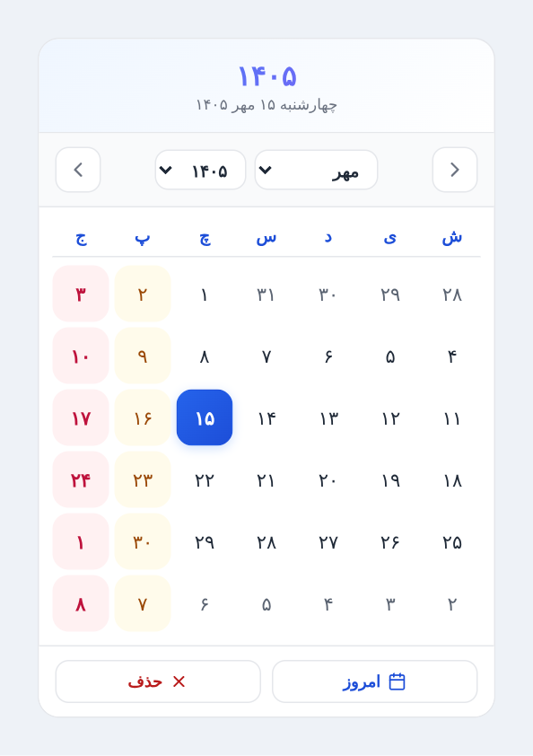

# 1. Getting started

[Docs home](../README.md) · **English** · [فارسی](../fa/01-getting-started.md) · Next: [Calendars & languages →](02-calendars-and-languages.md)



iZiDatePicker turns any text box into a date picker. You do **not** need a build tool or a framework: two files and three lines are enough.

## Step 1 - add the two files

```html
<link rel="stylesheet" href="izi-datepicker.css">
<script src="izi-datepicker.min.js"></script>
```

Where do the files come from?

| You use... | Do this |
|---|---|
| plain HTML | download `izi-datepicker.min.js` and `izi-datepicker.css` from the [latest release](https://github.com/yasproject/iZiDatePicker/releases) |
| a CDN (after the package is published) | `https://cdn.jsdelivr.net/npm/izi-datepicker@1/izi-datepicker.min.js` and `.../izi-datepicker.css` |
| npm / a bundler | `npm install izi-datepicker`, then `import iZiDatePicker from 'izi-datepicker'` and `import 'izi-datepicker/css'` |

## Step 2 - add a text box

```html
<input id="date" placeholder="Pick a date">
```

## Step 3 - start the picker

<!-- test -->
```js
const picker = new iZiDatePicker('#date');
```

That is all. Click the box and a calendar appears. By default it is the **Jalali (Persian)** calendar, written right-to-left. Want the Gregorian calendar in English instead?

<!-- test -->
```js
new iZiDatePicker('#range', { calendar: 'gregorian', locale: 'en' });
```

## Step 4 - get the date the user picked

You have three easy options.

<!-- test -->
```js
// 1. be told when something is picked
new iZiDatePicker('#start', {
  onSelect: (date, text) => console.log('picked', text, date.year, date.month, date.day)
});

// 2. ask at any time
const p = new iZiDatePicker('#end', { value: '1405/03/07' });
p.getValue();            // "1405/03/07"   the text in the box
p.getValue('iso');       // "2026-05-28"   always a Gregorian ISO date
p.getValue('gregorian'); // "2026/05/28"
p.getValue('jalali');    // "1405/03/07"
p.getValue('timestamp'); // 1779926400     Unix seconds
p.getValue('date');      // a JavaScript Date
p.getValue('object');    // { year: 1405, month: 3, day: 7, hour: 0, minute: 0, second: 0, jy: 1405, jm: 3, jd: 7 }

// 3. just read the <input> (it always holds machine-friendly text)
document.getElementById('end').value;
```

> **Good to know.** The date text inside the box uses Western digits (`1405/03/07`) on purpose, so your server and `<input>` validation can read it. Digits *on the calendar* are shown in the language's own digits. Both can be changed ([guide 2](02-calendars-and-languages.md#digits)).

## Step 5 - show the calendar all the time (inline)

Use `inline: true` and give it any element, such as a `<div>`:

<!-- test -->
```js
new iZiDatePicker('#cal', { inline: true, calendar: 'gregorian', locale: 'en' });
```

## No JavaScript at all? Use `data-izi`

Put the options as JSON in a `data-izi` attribute and add `data-auto-init` to the script tag:

```html
<input data-izi='{"mode":"range","presets":"default"}'>
<script src="izi-datepicker.min.js" data-auto-init></script>
```

## Which mode do I need?

| I want the user to pick... | Use |
|---|---|
| one date | `mode: 'single'` (default) |
| a start and an end | `mode: 'range'` |
| several separate dates | `mode: 'multiple'` |
| a whole week | `mode: 'week'` |
| a month | `mode: 'month'` |
| a time of day | `mode: 'time'` or `'timerange'` |
| a date **and** a time | `timePicker: true` |
| a booking slot | `timeSlots: { ... }` ([guide 5](05-time-and-booking.md)) |

Next: [Calendars & languages →](02-calendars-and-languages.md)
