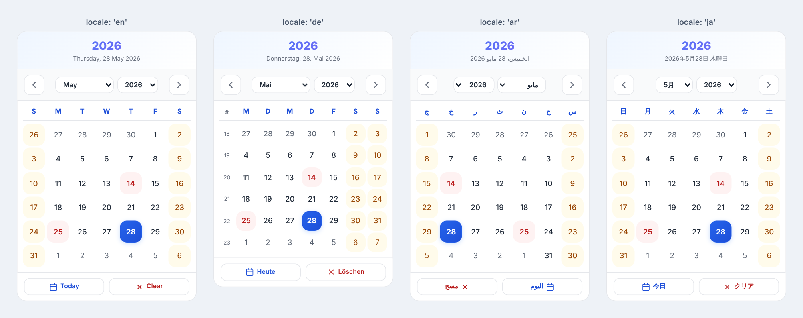

# 2. Calendars & languages

[Docs home](../README.md) · **English** · [فارسی](../fa/02-calendars-and-languages.md) · [← Getting started](01-getting-started.md) · Next: [Modes, ranges & quick ranges →](03-modes-ranges-presets.md)



## Pick a calendar

<!-- test -->
```js
new iZiDatePicker('#date', { calendar: 'jalali' });                      // the default
new iZiDatePicker('#range', { calendar: 'gregorian', locale: 'en' });
```

Both calendars can live on the **same page** without affecting each other.

## Languages (`locale`)

| Calendar | Values for `locale` | Where the words come from |
|---|---|---|
| Jalali | `'fa'` (default), `'en'`, `'fa-AF'` (Dari) | built in |
| Gregorian | **any** language tag your browser knows: `'en'`, `'de'`, `'ar'`, `'ja'`, `'pt-BR'`... | month and weekday names, AM/PM, digits, direction and the first day of the week come from the browser (`Intl`) |

The little interface words ("Today", "Clear", "Confirm"...) come from the optional **language pack**. It has ten languages: `ar de es fr it pt ru tr zh ja`. Without the pack those words are English.

```html
<script src="izi-datepicker.min.js"></script>
<script src="izi-datepicker.locales.js"></script>   <!-- the language pack -->
```
With npm: `import 'izi-datepicker/locales'`.

<!-- test -->
```js
new iZiDatePicker('#date', { calendar: 'gregorian', locale: 'de' });   // "Heute", "Löschen", Montag first
```

Missing your language? Add it in a few lines:

<!-- test -->
```js
iZiDatePicker.registerLocale('nl', { today: 'Vandaag', clear: 'Wissen', confirm: 'Bevestigen', cancel: 'Annuleren' });
new iZiDatePicker('#start', { calendar: 'gregorian', locale: 'nl' });
```

## Digits

| Option | What it controls | Default |
|---|---|---|
| `digits` | digits shown **on the calendar** | `'locale'` (Persian digits for `fa`) |
| `inputDigits` | digits written **in the text box** | `'latn'` (0-9, machine-friendly) |

Values: `'latn'` (0-9), `'fa'` (۰-۹) or `'locale'`.

<!-- test -->
```js
new iZiDatePicker('#date', { digits: 'latn', inputDigits: 'fa' });
```

Users may type in any digit system (Persian, Arabic-Indic, Western...) - the picker understands all of them.

## How the date is written (`format`)

<!-- test -->
```js
new iZiDatePicker('#date', { value: '1405/03/07', format: 'dddd D MMMM YYYY' });   // پنجشنبه 7 خرداد 1405
new iZiDatePicker('#range', { calendar: 'gregorian', locale: 'de', value: '2026-05-28', format: 'dddd, D. MMMM YYYY' });
```

| Token | Meaning | Token | Meaning |
|---|---|---|---|
| `YYYY` / `YY` | year | `HH` / `H` | hour 00-23 / 0-23 |
| `MMMM` / `MMM` | month name / short | `hh` / `h` | hour 01-12 / 1-12 |
| `MM` / `M` | month number | `mm` / `m` | minute |
| `DD` / `D` | day | `ss` / `s` | second |
| `dddd` / `ddd` | weekday name / short | `A` | AM/PM |

Put text in square brackets to keep it as is: `'[Year] YYYY'`. The default format is `YYYY/MM/DD` (Jalali) and `YYYY-MM-DD` (Gregorian).

## Typing dates

Users can type a date and press Enter or leave the box. For Gregorian dates like `05/28/2026`, say which order you expect:

<!-- test -->
```js
new iZiDatePicker('#date', { calendar: 'gregorian', locale: 'en', dateOrder: 'mdy', format: 'MM/DD/YYYY' });
```
`dateOrder: 'dmy'` (default) reads `28/05/2026`. Bad text is rejected: the box gets `aria-invalid="true"` and you receive the `invalidInput` event.

## Convert between calendars

<!-- test -->
```js
const p = new iZiDatePicker('#date', { value: '1405/03/07' });
p.getValue('gregorian');                         // "2026/05/28"
iZiDatePicker.converter.toGregorian(1405, 1, 1); // { gy: 2026, gm: 3, gd: 21 }
iZiDatePicker.converter.toJalali(2026, 3, 21);   // { jy: 1405, jm: 1, jd: 1 }
iZiDatePicker.gregorian.isLeap(2024);            // true
```

Want a Jalali calendar that **writes** Gregorian text (or the reverse)? Use `outputCalendar`:

<!-- test -->
```js
new iZiDatePicker('#date', { calendar: 'jalali', outputCalendar: 'gregorian' });
```

## First day of the week and weekends

Both are automatic: Saturday-first for Jalali, and the language's own convention for Gregorian (Sunday for `en-US`, Monday for `de`, Saturday for `ar`...). Override them when you need to:

<!-- test -->
```js
new iZiDatePicker('#date', { firstDayOfWeek: 'monday', weekend: ['saturday', 'sunday'] });
```

## Right-to-left and left-to-right

The direction follows the language. Force it with `dir: 'rtl'` or `dir: 'ltr'`.

## The supported years

The Jalali calendar is verified for the years **1300-1500** (the defaults of `minYear` / `maxYear`). The Gregorian calendar defaults to **1900-2100**. You can change both, but dates outside the verified range are not guaranteed.

Next: [Modes, ranges & quick ranges →](03-modes-ranges-presets.md)
