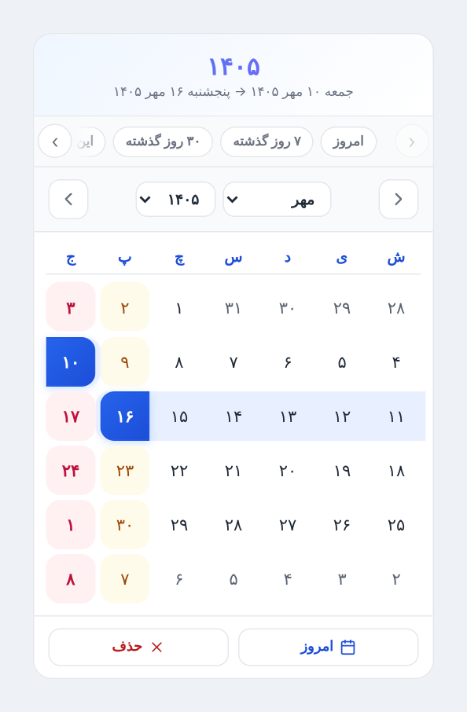
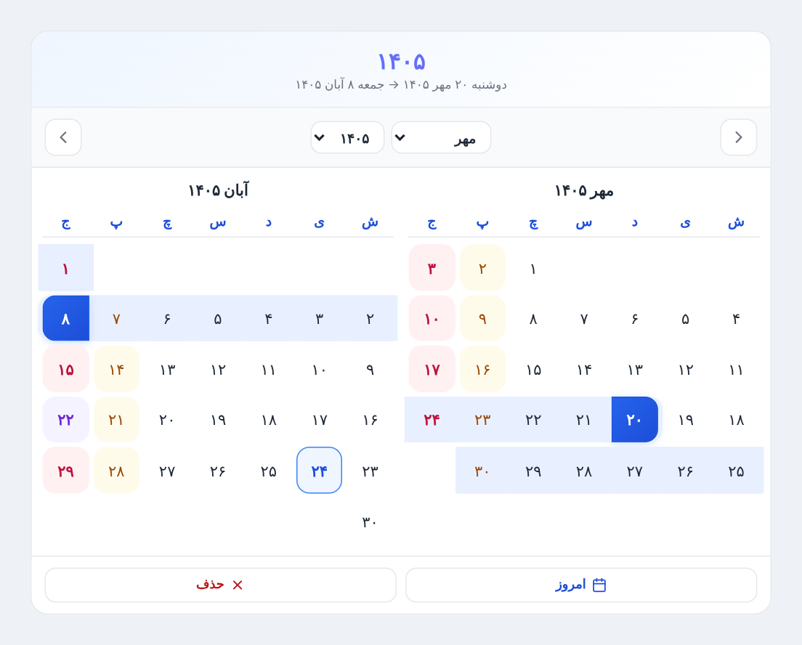

# 3. Modes, ranges & quick ranges

[Docs home](../README.md) · **English** · [فارسی](../fa/03-modes-ranges-presets.md) · [← Calendars & languages](02-calendars-and-languages.md) · Next: [Holidays →](04-holidays.md)



## The modes

<!-- test -->
```js
new iZiDatePicker('#date',  { mode: 'single' });     // one date (default)
new iZiDatePicker('#range', { mode: 'range' });      // start and end
new iZiDatePicker('#start', { mode: 'multiple', maxDates: 5 });   // several dates (0 = unlimited)
new iZiDatePicker('#end',   { mode: 'week' });       // click a day, get the whole week
new iZiDatePicker('#booking', { mode: 'month' });    // pick a month
```

What does `getValue()` give you?

| Mode | Text in the box | `getValue()` |
|---|---|---|
| `single` | `1405/03/07` | `"1405/03/07"` |
| `range` | `1405/03/01 - 1405/03/10` | `{ start: "1405/03/01", end: "1405/03/10" }` |
| `multiple` | `1405/03/01, 1405/03/10` | `["1405/03/01", "1405/03/10"]` |
| `week` | `1405/03/02 - 1405/03/08` | `{ start, end }` |
| `month` | `1405/03` | `"1405/03"` |

For a range you can also call `picker.getRange()`, which returns the two date objects (`start` and `end`).

## Block some dates

<!-- test -->
```js
new iZiDatePicker('#date', {
  minDate: '1405/01/01',            // nothing before this (write it in the picker's own calendar)
  maxDate: '1405/12/29',
  disablePast: true,                // or disableFuture: true
  disabledWeekdays: ['friday'],     // no Fridays
  disabledDates: ['1405/03/14'],    // specific days
  disabledRanges: [['1405/04/01', '1405/04/10']],
  disableHolidays: true,            // no holidays (or a type: 'official' / ['official', 'religious'])
  isDateDisabled: d => d.day === 13 // your own rule: return true to block
});
```

Blocked days are dimmed and cannot be clicked or picked with the keyboard.

## Range rules

<!-- test -->
```js
new iZiDatePicker('#range', {
  mode: 'range',
  minRangeDays: 3,          // at least 3 days (inclusive)
  maxRangeDays: 30,         // at most 30 days
  rangeBacktrack: 'swap',   // 2nd click before the 1st: swap them (default) or 'restart'
  rangeSpanDisabled: false  // false: a range may not contain a blocked day
});
```

## Quick ranges ("presets")

A bar of chips above the calendar, like "Today", "Last 7 days" or "This month":

<!-- test -->
```js
new iZiDatePicker('#range', { mode: 'range', presets: 'default' });
```

| `presets` value | What you get |
|---|---|
| `false` | no chips (default) |
| `'default'` | today, last 7 days, last 30 days, this month, last month |
| `'all'` | every built-in chip |
| `['today', 'last7', 'thisMonth']` | exactly these, in this order |
| `{ include: [...], exclude: [...], custom: [...] }` | start from a list, remove some, add your own |

Built-in ids: `today yesterday tomorrow` · `last7 last14 last30 last90 next7 next14 next30` · `thisWeek lastWeek nextWeek weekToDate` · `thisMonth lastMonth nextMonth monthToDate` · `thisQuarter lastQuarter thisYear lastYear yearToDate`. Any number works too: `last45`, `next10`...

Add your own chip - a fixed range or a function:

<!-- test -->
```js
new iZiDatePicker('#range', {
  mode: 'range',
  presets: {
    include: ['today', 'last7'],
    custom: [
      { id: 'spring', label: 'Spring', range: ['1405/01/01', '1405/03/31'] },
      { id: 'q', label: 'Next 90 days', range: () => [new Date(), new Date(Date.now() + 90 * 864e5)] }
    ]
  }
});
```

**Chips obey your rules.** If a chip would break `minRangeDays`, `maxRangeDays`, `minDate`, `maxDate` or a blocked day, it is greyed out with a tooltip explaining why. Change that with `presetsOverflow: 'disable'` (default), `'clamp'` (shrink the range to fit) or `'hide'`.

The chip bar can be dragged, scrolled with the mouse wheel, or moved with the arrows (`presetsArrows`). `presetsLayout: 'wrap'` shows all chips at once; `presetsPosition: 'bottom'` moves the bar below the calendar.

## Several months and drag-to-select



<!-- test -->
```js
new iZiDatePicker('#range', { mode: 'range', months: 2 });   // 1, 2 or 3 months
```

With a mouse (or pen) you can **press** on the first day, **drag** across the calendar - even into the next month - and **release** on the last day. Turn it off with `dragSelect: false`. When there is not enough room the months stack under each other automatically, and on phones they stack in the bottom sheet.

## Stop a selection yourself

<!-- test -->
```js
new iZiDatePicker('#date', {
  onBeforeSelect: (date, payload, picker) => date.day !== 13   // return false to refuse
});
```

## Week numbers and a second calendar

<!-- test -->
```js
new iZiDatePicker('#date', { showWeekNumbers: true, secondaryCalendar: 'gregorian' });
```
`secondaryCalendar` writes a small second date under every day: `'gregorian'`, `'jalali'` or `'hijri'` (an approximation).

## The keyboard

| Key | Action | Key | Action |
|---|---|---|---|
| Arrows | move one day / week (follow the reading direction) | `Page Up/Down` | previous / next month |
| `Shift` + `Page Up/Down` | previous / next year | `Home` / `End` | start / end of the week |
| `Enter` / `Space` | pick the day | `Esc` | close |

Next: [Holidays →](04-holidays.md)
