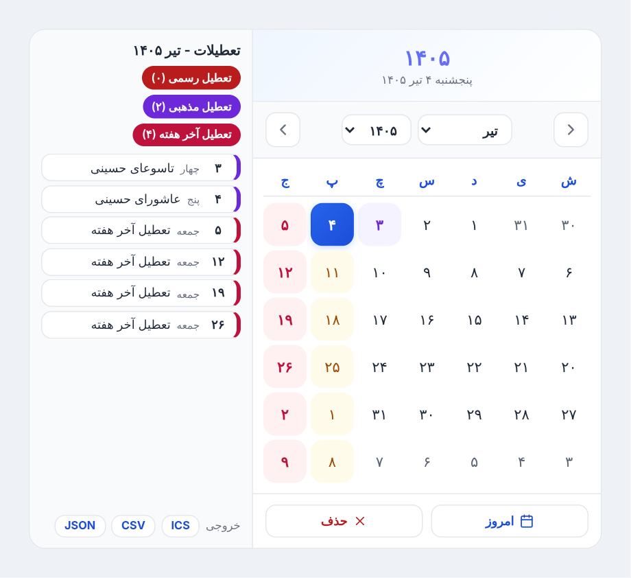

# 4. Holidays

[Docs home](../README.md) · **English** · [فارسی](../fa/04-holidays.md) · [← Modes, ranges & quick ranges](03-modes-ranges-presets.md) · Next: [Time & booking →](05-time-and-booking.md)



iZiDatePicker can colour holidays, explain them in a tooltip, block them, list them next to the calendar and export them. Holidays come in three types, each with its own colour:

| Type | Meaning | Default colour |
|---|---|---|
| `official` | official non-working day | red |
| `religious` | religious / lunar day | purple |
| `weekly` | weekly day off (Fridays in the Jalali calendar) | yellow / amber |

## What you get without doing anything

> **Be honest about the data.** Religious holidays follow the moon, so they change every year and cannot be calculated reliably. iZiDatePicker does **not** guess them.

| Calendar | Out of the box |
|---|---|
| Jalali | the **fixed solar-calendar holidays** (Nowruz, 12-13 Farvardin, 14-15 Khordad, 22 Bahman, 29 Esfand) every year, plus Fridays |
| Gregorian | **no holidays** - every country is different, so you supply them |

The official Iranian list for **Jalali year 1405** (including the religious days) ships as a separate file, `data/holidays/bundle.js`. It is the only year that was verified. Load it like this:

```html
<script src="izi-datepicker.min.js"></script>
<script src="data/holidays/bundle.js"></script>   <!-- defines iZiHolidays -->
<script>new iZiDatePicker('#date', { holidays: { data: iZiHolidays } });</script>
```

## Give it your own holidays

### A) A small list inside your page

<!-- test -->
```js
new iZiDatePicker('#date', {
  holidays: {
    data: {
      1406: [                                              // keyed by Jalali year
        { jm: 1, jd: 1, title: 'Nowruz', type: 'official' },
        { jm: 4, jd: 10, title: 'A religious day', type: 'religious' }
      ]
    }
  }
});
```

For a **Gregorian** calendar, add the days that repeat every year with `fixed`:

<!-- test -->
```js
new iZiDatePicker('#range', {
  calendar: 'gregorian', locale: 'en',
  holidays: { fixed: [{ m: 1, d: 1, title: "New Year's Day" }, { m: 12, d: 25, title: 'Christmas Day' }] }
});
```

### B) Load them from a file or an API

<!-- test -->
```js
new iZiDatePicker('#date', {
  holidays: {
    sources: [
      { type: 'url', url: '/holidays/{year}.json' },          // {year} = the year being shown
      { type: 'api', url: 'https://api.example.com/holidays', params: { year: '{year}' },
        headers: { Authorization: 'Bearer MY_TOKEN' },
        path: 'result.items',                                   // where the array is in the response
        fields: { date: 'day', title: 'name', type: 'kind' },   // map YOUR field names
        typeMap: { rel: 'religious', gov: 'official' } },       // translate YOUR type words
      { type: 'url', url: '/calendar/{year}.ics', format: 'ics' }   // an iCalendar file
    ],
    cache: 'storage'            // remember the answers in localStorage
  }
});
```

Years are loaded **only when the user looks at them**, in the background. While a year loads the calendar works normally; when the data arrives it is highlighted. If a source fails, the picker keeps working with what it has and fires `holidaysError`.

All source types:

| `type` | Use it for |
|---|---|
| `json` | data already in your page: `{ type: 'json', data: ... }` |
| `map` | a date-keyed object: `{ '2026-12-25': 'Christmas Day' }` |
| `dom` | JSON inside `<script type="application/json" id="h">` -> `{ type: 'dom', selector: '#h' }` |
| `url` / `api` | HTTP: `url`, `method`, `headers`, `params`, `body`, `timeoutMs`, `format: 'json' \| 'ics' \| 'csv'` |
| `provider` | your own async function: `{ type: 'provider', fn: async year => [...] }` |
| `pack` | a versioned data pack (see below) |

Useful extras on any source: `name`, `years` / `from` / `to` (limit it to some years), `path`, `fields`, `typeMap`, `transform`. Use `merge: 'all'` to combine several sources instead of "first one with data wins".

What an entry may look like - any of these work:

```js
{ jm: 1, jd: 1, title: 'Nowruz', type: 'official' }     // month + day in the picker's calendar
{ date: '2026-12-25', title: 'Christmas Day' }           // Gregorian ISO date
{ shamsiDate: '1405/01/01', title: '...' }               // Jalali date text
```

### C) A data pack (recommended for many years)

A pack is a folder: `manifest.json` (which years exist, with a hash) plus one file per year.

<!-- test -->
```js
new iZiDatePicker('#date', {
  holidays: { sources: [{ type: 'pack', base: '/holidays/' }], cache: 'storage' }
});
```

* Years that the manifest does not list are **not an error** - the picker just uses its built-in layer.
* Cached years are re-checked against the manifest **once per session** and reloaded only when the hash changed (offline first, always fresh).
* Build and validate packs with the tools in [`tools/`](../../tools): `node tools/build-holidays.mjs` checks every yearly file (dates must agree, copies of the previous year are rejected), and `node tools/update-holidays.mjs --url "https://.../{year}" --years 1405-1410 --check` downloads and compares; it exits with code 2 when something changed upstream. The repository's weekly workflow does this for you and opens a pull request.

## Choose what is highlighted or blocked

<!-- test -->
```js
new iZiDatePicker('#date', {
  highlightHolidays: true,        // colour them (default)
  highlightWeekend: true,
  tooltip: true,                  // hover to see the holiday name
  disableHolidays: ['official'],  // true = all types, or a list of types
  weeklyHolidays: ['friday'],     // which weekdays are the weekly day off
  holidays: false                 // turn the whole holiday system off
});
```

## The holiday list panel


<!-- test -->
```js
new iZiDatePicker('#date', {
  holidayList: {
    position: 'side',                  // 'side' or 'bottom'
    listScope: 'year',                 // 'view' = the shown month(s) (default), 'year' = the whole year, grouped by month
    types: ['official', 'religious'],  // which types start switched on
    export: ['ics', 'csv', 'json'],    // download buttons
    onClick: 'locate'                  // 'locate' or 'select'
  }
});
```

* **Filter chips** switch a type on or off. They change the list **and** the colours in the calendar.
* **Hover** an item and its day gets a dashed outline.
* **Click** an item and the calendar jumps to that day (changing month if needed). The day gets a solid outline with a short pulse, and screen readers hear its name. `onClick: 'select'` also selects the day.

## Export holidays

<!-- test -->
```js
const p = new iZiDatePicker('#date', { holidays: { data: { 1406: [{ jm: 1, jd: 1, title: 'Nowruz' }] } } });
p.exportHolidays({ year: 1406, format: 'ics' }).then(text => console.log(text.split('\r\n')[0])); // BEGIN:VCALENDAR
p.listHolidays({ year: 1406 }).then(list => console.log(list.length, list[0].date, list[0].title));
p.downloadHolidays({ year: 1406, format: 'csv', filename: 'holidays.csv' });   // browser download
```

`format` is `'ics'`, `'csv'`, `'json'` (text) or `'object'` (a plain array). These methods wait for lazy sources to finish loading.

## Events

<!-- test -->
```js
new iZiDatePicker('#date', {
  onHolidaysLoaded: ({ year, source }) => console.log('loaded', year, source),
  onHolidaysError: ({ year, error }) => console.warn('could not load', year, error)
});
```

Next: [Time & booking →](05-time-and-booking.md)
