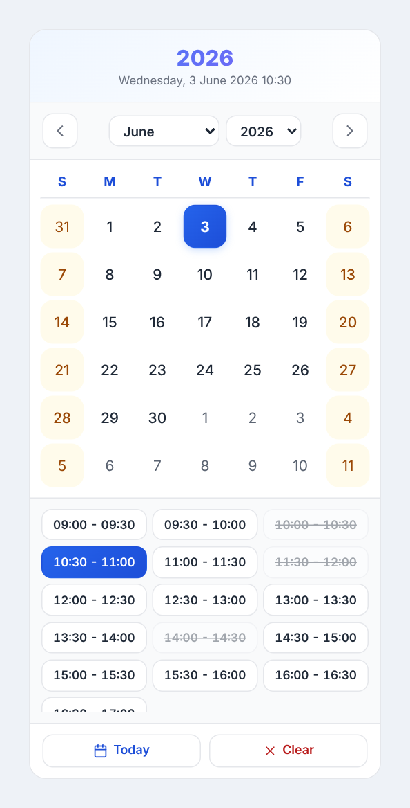
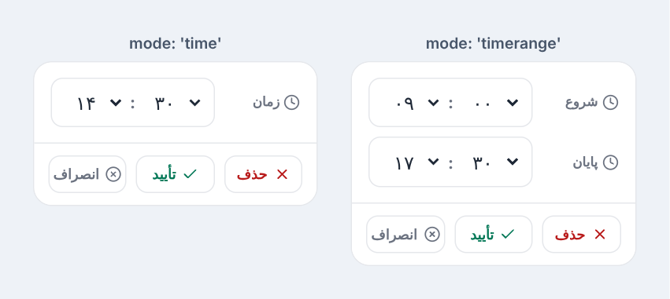

# 5. Time & booking

[Docs home](../README.md) · **English** · [فارسی](../fa/05-time-and-booking.md) · [← Holidays](04-holidays.md) · Next: [Compare two ranges →](06-compare-ranges.md)



## A date **and** a time

<!-- test -->
```js
new iZiDatePicker('#date', {
  timePicker: true,
  timeFormat: '24h',     // or '12h' (with AM/PM)
  timeStep: 5,           // minute steps: 1, 5, 10, 15, 30...
  showSeconds: false,
  minTime: '08:00',      // earliest / latest allowed time
  maxTime: '20:00',
  defaultTime: '09:00'   // the time used before the user touches the selectors
});
```

When a time selector is on, the picker waits for the user to press **Confirm** (`confirm: 'auto'`). Use `confirm: false` to commit immediately, or `confirm: true` to always ask.

For a range with times use `mode: 'range'` together with `timePicker: true`, and `defaultEndTime` for the end.

## Only a time (no calendar)



<!-- test -->
```js
new iZiDatePicker('#time', { mode: 'time', timeFormat: '24h' });                 // "14:30"
new iZiDatePicker('#booking', { mode: 'timerange', timeFormat: '24h' });         // "09:00 - 17:30"
```

The user can also **type** `14:30` or `2:30 PM`. In a time range the end can never be before the start.

<!-- test -->
```js
const t = new iZiDatePicker('#start', { mode: 'timerange', value: ['09:00', '17:30'], timeFormat: '24h' });
t.getValue('time');   // { start: '09:00', end: '17:30' }
```

For `mode: 'time'`, `getValue('time')` returns `'14:30'`.

## Booking slots

A grid of times (like a doctor's appointment page): the user picks a **date**, then a **slot**.

<!-- test -->
```js
const booking = new iZiDatePicker('#booking', {
  calendar: 'gregorian', locale: 'en', timeFormat: '24h',
  timeSlots: {
    step: 30,                 // a slot starts every 30 minutes
    duration: 30,             // and lasts 30 minutes (0 = just a time, no end)
    min: '09:00',             // first slot
    max: '17:00',             // the last slot ends by this time
    columns: 3,               // buttons per row
    showEnd: true,            // label "09:00 - 09:30"
    disabled: (date, time) => date.day % 2 === 0 && time === '11:00'   // true = already taken
  },
  onSelect: (date, text) => console.log(text)       // "2026-06-03 10:30 - 11:00"
});
```

* Slots stay disabled until a date is chosen, and a hint says why.
* `disabled` can be a **function** `(date, 'HH:mm') => boolean` or simply a **list** of taken times: `disabled: ['10:00', '11:30']`.
* The end time is calculated from `duration`. Read it with `booking.getRange()`, or from the `select` event (`payload.end`):

<!-- test -->
```js
const b = new iZiDatePicker('#end', { calendar: 'gregorian', locale: 'en', timeSlots: {} });
b.on('select', ({ value, end, formatted }) => console.log(value.hour, end.hour, formatted));
```

### Availability from your server

Taken slots usually come from a server. Load them, then update the options:

<!-- test -->
```js
const picker = new iZiDatePicker('#date', { calendar: 'gregorian', locale: 'en', timeSlots: { step: 60 } });
picker.on('select', async ({ value }) => {
  const res = await fetch('/api/taken?date=' + picker.getValue('iso'));    // e.g. ["10:00","15:00"]
  const taken = await res.json();
  picker.setOptions({ timeSlots: { step: 60, disabled: taken } });
});
```

> Slots work with `mode: 'single'`. Times are plain `HH:mm` strings; time zones are your server's business.

Next: [Compare two ranges →](06-compare-ranges.md)
