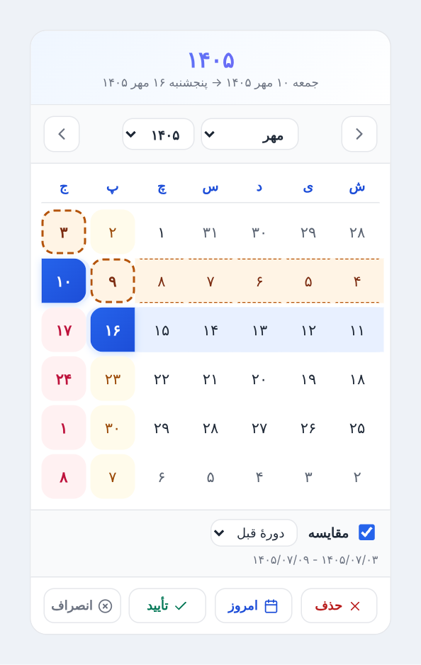

# 6. Compare two ranges

[Docs home](../README.md) · **English** · [فارسی](../fa/06-compare-ranges.md) · [← Time & booking](05-time-and-booking.md) · Next: [Styling & themes →](07-styling-and-themes.md)



Dashboards often show "this month **vs** last month". Turn it on with one option:

<!-- test -->
```js
new iZiDatePicker('#range', { mode: 'range', compare: true });
```

A **Compare** row appears under the calendar. Tick it, choose how to compare, pick your range, press **Confirm**. The comparison range is drawn with a dashed amber outline so it can never be mixed up with the main range.

## Ways to compare

| `mode` | The comparison range is... |
|---|---|
| `'previousPeriod'` | the same number of days **right before** your range |
| `'previousYear'` | the same dates, one year earlier (leap days are handled) |
| `'custom'` | any range you pick yourself (click **Comparison range**, then two days) |

<!-- test -->
```js
new iZiDatePicker('#range', {
  mode: 'range',
  compare: {
    modes: ['previousPeriod', 'previousYear', 'custom'],  // which choices to offer
    mode: 'previousPeriod',                               // the starting choice
    enabled: false,                                       // start ticked or not
    separator: ' vs '                                     // text between the two ranges
  }
});
```

It also works with `mode: 'week'` and together with quick ranges: click "This month" and the previous month is compared automatically.

## Read the result

<!-- test -->
```js
const p = new iZiDatePicker('#range', {
  mode: 'range', compare: { enabled: true }, value: ['1405/07/10', '1405/07/16'],
  onRangeSelect: (start, end, text) => console.log(text)     // "1405/07/10 - 1405/07/16 vs 1405/07/03 - 1405/07/09"
});
p.on('rangeSelect', ({ start, end, compare }) => {
  // compare is null when the checkbox is off, otherwise { start, end } (date objects)
  console.log(start.day, end.day, compare && compare.start.day);
});
p.getCompare();                  // { start, end } or null
p.getValue('jalali');            // { start: '1405/07/10', end: '1405/07/16', compare: { start: '1405/07/03', end: '1405/07/09' } }
p.getValue();                    // the same, as text: "1405/07/10 - 1405/07/16 vs 1405/07/03 - 1405/07/09"
```

You can also **set** it, with text or an object:

<!-- test -->
```js
const q = new iZiDatePicker('#range', { mode: 'range', compare: true });
q.setValue('1405/07/10 - 1405/07/16 vs 1405/05/01 - 1405/05/07');
q.setValue({ start: '1405/08/01', end: '1405/08/10', compare: { start: '1405/06/01', end: '1405/06/10' } });
```

> A comparison that would fall outside the supported years is simply left out (no error). When the compare option is on, the picker waits for **Confirm**, so the user can adjust the comparison after choosing dates.

Next: [Styling & themes →](07-styling-and-themes.md)
