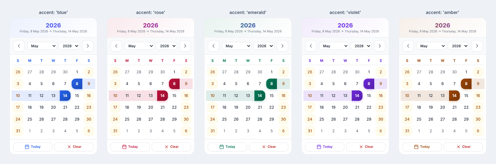
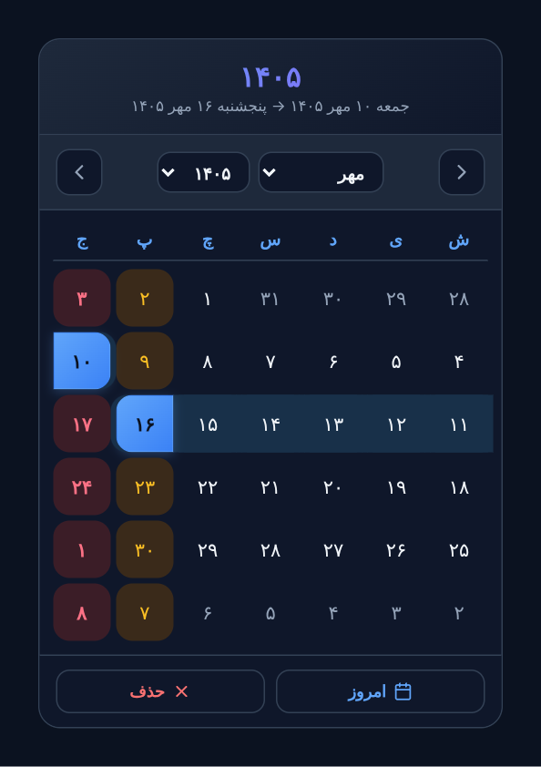
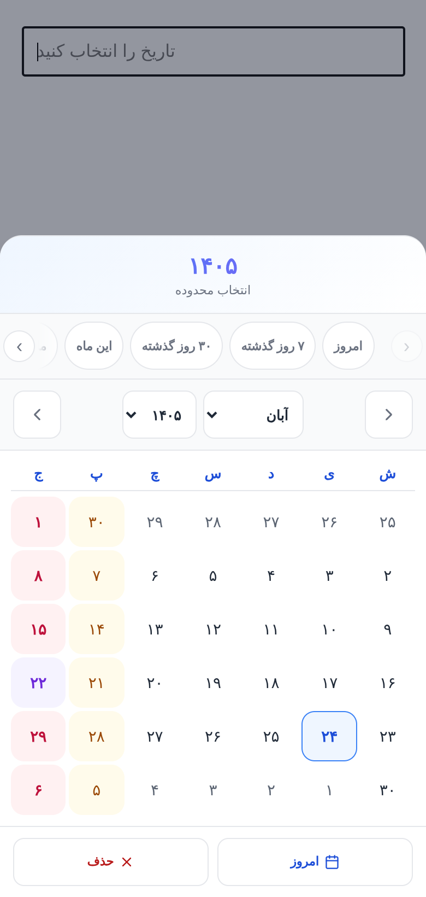

# 7. Styling, themes & mobile

[Docs home](../README.md) · **English** · [فارسی](../fa/07-styling-and-themes.md) · [← Compare two ranges](06-compare-ranges.md) · Next: [Frameworks & advanced →](08-frameworks-and-advanced.md)



## Size

<!-- test -->
```js
new iZiDatePicker('#date', { size: 'lg' });                 // xs 260px | sm 300 | md 340 (default) | lg 400 | xl 480 | fluid (100%)
new iZiDatePicker('#range', { width: 360, fontSize: 15 });  // exact width and base font size (everything scales with it)
```

## Colours in one line

Give **one** colour and the whole palette (selection, hover, range band, focus ring) is derived from it:

<!-- test -->
```js
new iZiDatePicker('#date', { accent: 'rose' });      // blue ocean rose emerald violet amber slate
new iZiDatePicker('#range', { accent: '#0ea5e9' });  // or any CSS colour
```

## Light, dark or automatic



<!-- test -->
```js
new iZiDatePicker('#date', { theme: 'dark' });   // 'light' | 'dark' | 'auto' (follows the device)
```

## Fine control

<!-- test -->
```js
new iZiDatePicker('#date', {
  cellShape: 'circle',          // 'rounded' | 'circle' | 'square'
  density: 'compact',           // 'compact' | 'normal' | 'comfortable'
  radius: 'xl',                 // 'none' | 'sm' | 'md' | 'lg' | 'xl' | a number in px
  shadow: 'lg',                 // 'none' | 'sm' | 'md' | 'lg'
  weekdayFormat: 'short',       // 'narrow' (1 letter) | 'short' | 'long'
  fontFamily: 'Vazirmatn, system-ui, sans-serif',
  showOutsideDays: false,       // blank cells instead of the neighbouring months' days
  showWeekdays: true,
  highlightToday: true,
  animation: 'fade',            // or 'none' (users who prefer reduced motion never get animation)
  colors: { primary: '#7c3aed', range: '#ede9fe', holiday: '#dc2626', weekend: '#b45309' }
});
```

`colors` keys: `primary background surface text textSecondary border hover range onPrimary faded today weekend weekendBg holiday holidayBg religious religiousBg weekly weeklyBg danger success`.

## Your own CSS

Every class starts with `izi-`, every CSS variable with `--izi-`. Three ways to customise, from easiest to most powerful:

**1. CSS variables** (all `--izi-*`: `--izi-primary`, `--izi-radius`, `--izi-gap`, `--izi-font-size`...)

```css
.my-picker { --izi-primary: #7c3aed; --izi-radius: 20px; }
```
<!-- test -->
```js
new iZiDatePicker('#date', { customClass: 'my-picker', cssVars: { '--izi-gap': '4px' } });
```

**2. Add class names to the parts**

<!-- test -->
```js
new iZiDatePicker('#date', { classNames: { root: 'shadow-xl', selected: 'my-selected', chip: 'my-chip', button: 'btn' } });
```
(parts: `root preview header presets chip grid weekday cell today selected inRange disabled holiday weekend outside footer button`) - handy with Tailwind or Bootstrap.

**3. Render parts yourself**

<!-- test -->
```js
new iZiDatePicker('#date', {
  renderDay: cell => cell.holiday && cell.holiday.types.length ? cell.text + ' ★' : undefined,   // undefined = keep the default
  renderFooter: state => 'Showing ' + state.view.title                                         // a string is inserted as plain text
});
```
Strings you return are inserted as **text**, never as HTML. Return a DOM element (or fragment) when you need markup. Use `data-act="prev"` / `"next"` on your own buttons in `renderHeader`.

## Buttons and layout

<!-- test -->
```js
new iZiDatePicker('#date', {
  showPreview: true,            // the big title with the chosen date at the top
  showMonthYearSelector: true,  // the month and year drop-downs
  showButtonIcons: true,
  footerButtons: ['today', 'clear'],   // 'auto' | 'none' | any of today / clear / confirm / cancel / your own { id, text, onClick }
  yearPicker: 'grid'            // a paged grid of years instead of a drop-down (nicer on phones)
});
```

## Where the popup appears

<!-- test -->
```js
new iZiDatePicker('#date', {
  appendTo: 'body',       // put the popup inside another element (for modals, scrolling boxes)
  position: 'auto',       // 'auto' | 'top' | 'bottom'
  zIndex: 10000,          // raise it above your own layers
  strategy: 'fixed',      // use 'absolute' inside transformed containers
  closeOnSelect: true, closeOnOutsideClick: true, openOn: 'click'   // 'click' | 'focus' | 'both'
});
```
A popup is never taller than the screen - it scrolls instead of being cut off - and it repositions itself if its size changes while open.

## Phones and tablets



On screens up to 520 px wide the calendar opens as a **bottom sheet**: bigger tap targets (44 px), swipe left/right to change month, the page behind does not scroll, and the on-screen keyboard stays closed. Control it:

<!-- test -->
```js
new iZiDatePicker('#date', {
  sheet: 'auto',            // 'auto' | true | false
  swipe: true,
  suppressKeyboard: 'auto', // don't pop the keyboard up when tapping the input
  lockScroll: true
});
```

## Accessibility

* The calendar is a proper dialog with a labelled grid; every day has a full spoken label (for example "Friday 25 December 2026, Christmas Day").
* Everything works with the keyboard (see [guide 3](03-modes-ranges-presets.md#the-keyboard)); focus returns to the input when the popup closes (`restoreFocus`).
* Changes are announced through a live region.
* Colours meet **WCAG AA** contrast in light and dark themes (checked with axe-core).
* Users who prefer reduced motion get no animation.

Next: [Frameworks & advanced →](08-frameworks-and-advanced.md)
