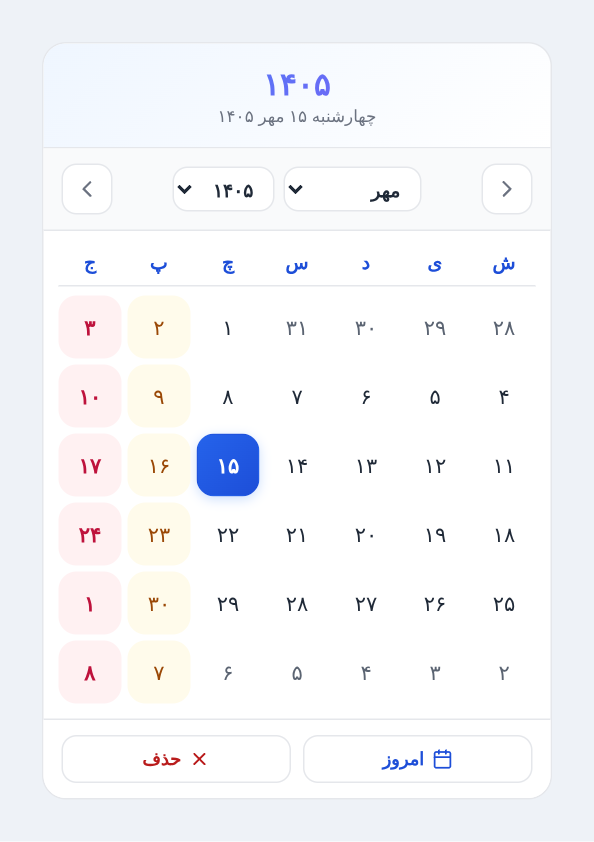

<div dir="rtl">

# ۱. شروع سریع

[فهرست مستندات](../README.md) · [English](../en/01-getting-started.md) · **فارسی** · بعدی: [تقویم‌ها و زبان‌ها ←](02-calendars-and-languages.md)



iZiDatePicker هر کادر متنی را به یک انتخابگر تاریخ تبدیل می‌کند. **نیازی به ابزار ساخت یا فریم‌ورک نیست**: دو فایل و سه خط کد کافی است.

## گام ۱ - دو فایل را اضافه کنید

```html
<link rel="stylesheet" href="izi-datepicker.css">
<script src="izi-datepicker.min.js"></script>
```

این فایل‌ها را از کجا بگیرم؟

| اگر از ... استفاده می‌کنید | این کار را بکنید |
|---|---|
| HTML ساده | فایل‌های `izi-datepicker.min.js` و `izi-datepicker.css` را از [آخرین نسخه](https://github.com/yasproject/iZiDatePicker/releases) دانلود کنید |
| CDN (بعد از انتشار بسته) | `https://cdn.jsdelivr.net/npm/izi-datepicker@1/izi-datepicker.min.js` و `.../izi-datepicker.css` |
| npm یا باندلر | `npm install izi-datepicker` و سپس `import iZiDatePicker from 'izi-datepicker'` و `import 'izi-datepicker/css'` |

## گام ۲ - یک کادر متنی بگذارید

```html
<input id="date" placeholder="تاریخ را انتخاب کنید">
```

## گام ۳ - تقویم را راه بیندازید

<!-- test -->
```js
const picker = new iZiDatePicker('#date');
```

تمام! روی کادر کلیک کنید تا تقویم باز شود. پیش‌فرض، **تقویم شمسی (جلالی)** و راست‌به‌چپ است. می‌خواهید تقویم میلادی و انگلیسی باشد؟

<!-- test -->
```js
new iZiDatePicker('#range', { calendar: 'gregorian', locale: 'en' });
```

## گام ۴ - تاریخ انتخاب‌شده را بگیرید

سه راه ساده دارید.

<!-- test -->
```js
// 1. be told when something is picked
new iZiDatePicker('#start', {
  onSelect: (date, text) => console.log('picked', text, date.year, date.month, date.day)
});

// 2. ask at any time
const p = new iZiDatePicker('#end', { value: '1405/03/07' });
p.getValue();            // "1405/03/07"   the text in the box
p.getValue('iso');       // "2026-05-28"   always a Gregorian ISO date
p.getValue('gregorian'); // "2026/05/28"
p.getValue('jalali');    // "1405/03/07"
p.getValue('timestamp'); // 1779926400     Unix seconds
p.getValue('date');      // a JavaScript Date
p.getValue('object');    // { year: 1405, month: 3, day: 7, hour: 0, minute: 0, second: 0, jy: 1405, jm: 3, jd: 7 }

// 3. just read the <input> (it always holds machine-friendly text)
document.getElementById('end').value;
```

> **نکته.** متن تاریخ داخل کادر عمداً با ارقام انگلیسی نوشته می‌شود (`1405/03/07`) تا سرور و اعتبارسنجی فرم بتوانند آن را بخوانند. ارقام *روی تقویم* به‌صورت پیش‌فرض با رقم‌های همان زبان (فارسی) نمایش داده می‌شود. هر دو قابل تغییرند ([راهنمای ۲](02-calendars-and-languages.md#ارقام)).

## گام ۵ - تقویم همیشه نمایان باشد (inline)

گزینهٔ `inline: true` را بدهید و هر عنصری مثل `<div>` را معرفی کنید:

<!-- test -->
```js
new iZiDatePicker('#cal', { inline: true, calendar: 'gregorian', locale: 'en' });
```

## بدون جاوااسکریپت؟ از `data-izi` استفاده کنید

گزینه‌ها را به‌صورت JSON در صفتِ `data-izi` بنویسید و به تگ script صفتِ `data-auto-init` را اضافه کنید:

```html
<input data-izi='{"mode":"range","presets":"default"}'>
<script src="izi-datepicker.min.js" data-auto-init></script>
```

## کدام حالت (mode) را بگذارم؟

| می‌خواهم کاربر انتخاب کند ... | استفاده کنید |
|---|---|
| یک تاریخ | `mode: 'single'` (پیش‌فرض) |
| شروع و پایان | `mode: 'range'` |
| چند تاریخ جدا از هم | `mode: 'multiple'` |
| یک هفتهٔ کامل | `mode: 'week'` |
| یک ماه | `mode: 'month'` |
| ساعتِ روز | `mode: 'time'` یا `'timerange'` |
| تاریخ **و** ساعت | `timePicker: true` |
| یک زمان رزرو | `timeSlots: { ... }` ([راهنمای ۵](05-time-and-booking.md)) |

بعدی: [تقویم‌ها و زبان‌ها ←](02-calendars-and-languages.md)

</div>
