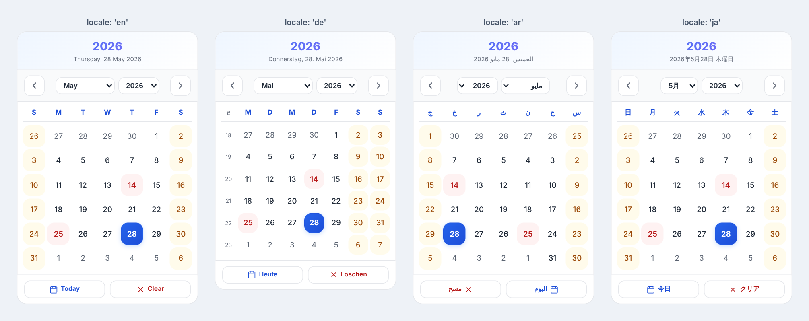

<div dir="rtl">

# ۲. تقویم‌ها و زبان‌ها

[فهرست مستندات](../README.md) · [English](../en/02-calendars-and-languages.md) · **فارسی** · [→ شروع سریع](01-getting-started.md) · بعدی: [حالت‌ها، بازه‌ها و میانبرها ←](03-modes-ranges-presets.md)



## تقویم را انتخاب کنید

<!-- test -->
```js
new iZiDatePicker('#date', { calendar: 'jalali' });                      // the default
new iZiDatePicker('#range', { calendar: 'gregorian', locale: 'en' });
```

هر دو تقویم می‌توانند **در یک صفحه** باشند و روی هم اثر نمی‌گذارند.

## زبان‌ها (`locale`)

| تقویم | مقدارهای `locale` | نام‌ها از کجا می‌آیند |
|---|---|---|
| شمسی | `'fa'` (پیش‌فرض)، `'en'`، `'fa-AF'` (دری) | داخل کتابخانه |
| میلادی | **هر** زبانی که مرورگر بشناسد: `'en'`، `'de'`، `'ar'`، `'ja'`، `'pt-BR'` و ... | نام ماه و روز، AM/PM، ارقام، جهت نوشتار و اولین روز هفته از خود مرورگر (`Intl`) |

کلمه‌های کوچک رابط («امروز»، «حذف»، «تأیید» و ...) از **بستهٔ زبان** اختیاری می‌آیند. ده زبان دارد: `ar de es fr it pt ru tr zh ja`. بدون این بسته آن کلمه‌ها انگلیسی‌اند.

```html
<script src="izi-datepicker.min.js"></script>
<script src="izi-datepicker.locales.js"></script>   <!-- بستهٔ زبان -->
```
با npm: `import 'izi-datepicker/locales'`.

<!-- test -->
```js
new iZiDatePicker('#date', { calendar: 'gregorian', locale: 'de' });   // "Heute", "Löschen", Montag first
```

زبان شما نیست؟ با چند خط اضافه‌اش کنید:

<!-- test -->
```js
iZiDatePicker.registerLocale('nl', { today: 'Vandaag', clear: 'Wissen', confirm: 'Bevestigen', cancel: 'Annuleren' });
new iZiDatePicker('#start', { calendar: 'gregorian', locale: 'nl' });
```

## ارقام

| گزینه | چه چیزی را تعیین می‌کند | پیش‌فرض |
|---|---|---|
| `digits` | ارقامِ **روی تقویم** | `'locale'` (برای `fa` رقم فارسی) |
| `inputDigits` | ارقامی که **داخل کادر** نوشته می‌شود | `'latn'` (0-9، قابل‌خواندن برای ماشین) |

مقدارها: `'latn'` (0-9)، `'fa'` (۰-۹) یا `'locale'`.

<!-- test -->
```js
new iZiDatePicker('#date', { digits: 'latn', inputDigits: 'fa' });
```

کاربر می‌تواند با هر نوع رقمی (فارسی، عربی، انگلیسی ...) تایپ کند؛ تقویم همه را می‌فهمد.

## تاریخ چطور نوشته شود (`format`)

<!-- test -->
```js
new iZiDatePicker('#date', { value: '1405/03/07', format: 'dddd D MMMM YYYY' });   // پنجشنبه 7 خرداد 1405
new iZiDatePicker('#range', { calendar: 'gregorian', locale: 'de', value: '2026-05-28', format: 'dddd, D. MMMM YYYY' });
```

| نشانه | معنی | نشانه | معنی |
|---|---|---|---|
| `YYYY` / `YY` | سال | `HH` / `H` | ساعت ۰۰-۲۳ / ۰-۲۳ |
| `MMMM` / `MMM` | نام ماه / کوتاه | `hh` / `h` | ساعت ۰۱-۱۲ / ۱-۱۲ |
| `MM` / `M` | شمارهٔ ماه | `mm` / `m` | دقیقه |
| `DD` / `D` | روز | `ss` / `s` | ثانیه |
| `dddd` / `ddd` | نام روز هفته / کوتاه | `A` | AM/PM |

متنی که داخل کروشه بگذارید بدون تغییر می‌ماند: `'[سال] YYYY'`. قالب پیش‌فرض `YYYY/MM/DD` (شمسی) و `YYYY-MM-DD` (میلادی) است.

## تایپ تاریخ

کاربر می‌تواند تاریخ را تایپ کند و Enter بزند یا از کادر خارج شود. برای تاریخ میلادی مثل `05/28/2026` بگویید چه ترتیبی انتظار دارید:

<!-- test -->
```js
new iZiDatePicker('#date', { calendar: 'gregorian', locale: 'en', dateOrder: 'mdy', format: 'MM/DD/YYYY' });
```

`dateOrder: 'dmy'` (پیش‌فرض) متن `28/05/2026` را می‌خواند. متن نادرست رد می‌شود: کادر `aria-invalid="true"` می‌گیرد و رویداد `invalidInput` را دریافت می‌کنید.

## تبدیل بین دو تقویم

<!-- test -->
```js
const p = new iZiDatePicker('#date', { value: '1405/03/07' });
p.getValue('gregorian');                         // "2026/05/28"
iZiDatePicker.converter.toGregorian(1405, 1, 1); // { gy: 2026, gm: 3, gd: 21 }
iZiDatePicker.converter.toJalali(2026, 3, 21);   // { jy: 1405, jm: 1, jd: 1 }
iZiDatePicker.gregorian.isLeap(2024);            // true
```

تقویم شمسی می‌خواهید که متن **میلادی** بنویسد (یا برعکس)؟ از `outputCalendar` استفاده کنید:

<!-- test -->
```js
new iZiDatePicker('#date', { calendar: 'jalali', outputCalendar: 'gregorian' });
```

## اولین روز هفته و آخر هفته

هر دو خودکارند: برای شمسی از شنبه، و برای میلادی طبق عرف همان زبان (یکشنبه برای `en-US`، دوشنبه برای `de`، شنبه برای `ar` و ...). هر وقت خواستید عوضشان کنید:

<!-- test -->
```js
new iZiDatePicker('#date', { firstDayOfWeek: 'monday', weekend: ['saturday', 'sunday'] });
```

## راست‌به‌چپ و چپ‌به‌راست

جهت از زبان پیروی می‌کند. با `dir: 'rtl'` یا `dir: 'ltr'` اجبارش کنید.

## سال‌های پشتیبانی‌شده

تقویم شمسی برای سال‌های **۱۳۰۰ تا ۱۵۰۰** راستی‌آزمایی شده است (پیش‌فرض `minYear` / `maxYear`). تقویم میلادی پیش‌فرض **۱۹۰۰ تا ۲۱۰۰** است. هر دو را می‌توانید تغییر دهید، اما بیرون از بازهٔ تأییدشده تضمینی نیست.

بعدی: [حالت‌ها، بازه‌ها و میانبرها ←](03-modes-ranges-presets.md)

</div>
