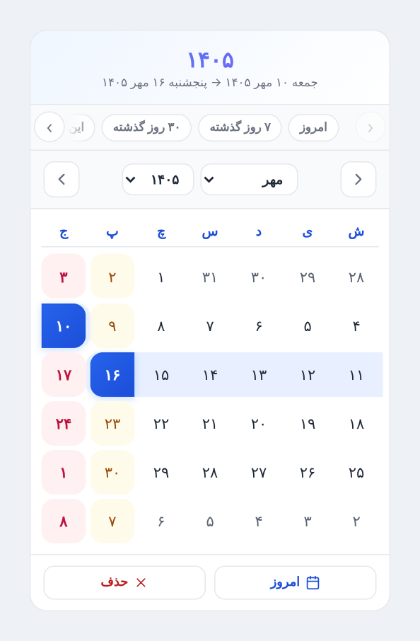
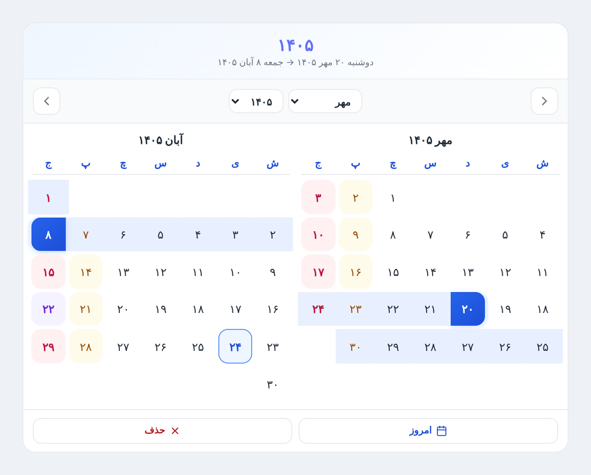

<div dir="rtl">

# ۳. حالت‌ها، بازه‌ها و میانبرها

[فهرست مستندات](../README.md) · [English](../en/03-modes-ranges-presets.md) · **فارسی** · [→ تقویم‌ها و زبان‌ها](02-calendars-and-languages.md) · بعدی: [تعطیلات ←](04-holidays.md)



## حالت‌ها

<!-- test -->
```js
new iZiDatePicker('#date',  { mode: 'single' });     // one date (default)
new iZiDatePicker('#range', { mode: 'range' });      // start and end
new iZiDatePicker('#start', { mode: 'multiple', maxDates: 5 });   // several dates (0 = unlimited)
new iZiDatePicker('#end',   { mode: 'week' });       // click a day, get the whole week
new iZiDatePicker('#booking', { mode: 'month' });    // pick a month
```

`getValue()` چه چیزی برمی‌گرداند؟

| حالت | متن داخل کادر | `getValue()` |
|---|---|---|
| `single` | `1405/03/07` | `"1405/03/07"` |
| `range` | `1405/03/01 - 1405/03/10` | `{ start: "1405/03/01", end: "1405/03/10" }` |
| `multiple` | `1405/03/01, 1405/03/10` | `["1405/03/01", "1405/03/10"]` |
| `week` | `1405/03/02 - 1405/03/08` | `{ start, end }` |
| `month` | `1405/03` | `"1405/03"` |

برای بازه می‌توانید `picker.getRange()` را هم صدا بزنید که دو شیء تاریخ (`start` و `end`) می‌دهد.

## بعضی تاریخ‌ها را ببندید

<!-- test -->
```js
new iZiDatePicker('#date', {
  minDate: '1405/01/01',            // nothing before this (write it in the picker's own calendar)
  maxDate: '1405/12/29',
  disablePast: true,                // or disableFuture: true
  disabledWeekdays: ['friday'],     // no Fridays
  disabledDates: ['1405/03/14'],    // specific days
  disabledRanges: [['1405/04/01', '1405/04/10']],
  disableHolidays: true,            // no holidays (or a type: 'official' / ['official', 'religious'])
  isDateDisabled: d => d.day === 13 // your own rule: return true to block
});
```

روزهای بسته‌شده کم‌رنگ‌اند و نه با موس و نه با صفحه‌کلید انتخاب نمی‌شوند.

## قانون‌های بازه

<!-- test -->
```js
new iZiDatePicker('#range', {
  mode: 'range',
  minRangeDays: 3,          // at least 3 days (inclusive)
  maxRangeDays: 30,         // at most 30 days
  rangeBacktrack: 'swap',   // 2nd click before the 1st: swap them (default) or 'restart'
  rangeSpanDisabled: false  // false: a range may not contain a blocked day
});
```

## میانبرها (بازه‌های سریع)

نواری از دکمه‌ها بالای تقویم، مثل «امروز»، «۷ روز گذشته» یا «این ماه»:

<!-- test -->
```js
new iZiDatePicker('#range', { mode: 'range', presets: 'default' });
```

| مقدار `presets` | نتیجه |
|---|---|
| `false` | بدون میانبر (پیش‌فرض) |
| `'default'` | امروز، ۷ روز گذشته، ۳۰ روز گذشته، این ماه، ماه گذشته |
| `'all'` | همهٔ میانبرهای آماده |
| `['today', 'last7', 'thisMonth']` | دقیقاً همین‌ها، به همین ترتیب |
| `{ include: [...], exclude: [...], custom: [...] }` | از یک فهرست شروع کنید، چندتا را حذف کنید و میانبر خودتان را اضافه کنید |

شناسه‌های آماده: `today yesterday tomorrow` · `last7 last14 last30 last90 next7 next14 next30` · `thisWeek lastWeek nextWeek weekToDate` · `thisMonth lastMonth nextMonth monthToDate` · `thisQuarter lastQuarter thisYear lastYear yearToDate`. هر عددی هم کار می‌کند: `last45`، `next10` و ...

میانبر خودتان را اضافه کنید، با یک بازهٔ ثابت یا یک تابع:

<!-- test -->
```js
new iZiDatePicker('#range', {
  mode: 'range',
  presets: {
    include: ['today', 'last7'],
    custom: [
      { id: 'spring', label: 'Spring', range: ['1405/01/01', '1405/03/31'] },
      { id: 'q', label: 'Next 90 days', range: () => [new Date(), new Date(Date.now() + 90 * 864e5)] }
    ]
  }
});
```

**میانبرها از قانون‌های شما پیروی می‌کنند.** اگر میانبری با `minRangeDays`، `maxRangeDays`، `minDate`، `maxDate` یا یک روز بسته‌شده تناقض داشته باشد، کم‌رنگ می‌شود و با یک راهنما دلیلش را می‌گوید. این رفتار را با `presetsOverflow: 'disable'` (پیش‌فرض)، `'clamp'` (بازه را کوتاه می‌کند تا جا شود) یا `'hide'` عوض کنید.

نوار میانبرها را می‌توانید بکشید، با چرخ موس حرکت دهید یا با دکمه‌های کناری جابه‌جا کنید (`presetsArrows`). `presetsLayout: 'wrap'` همهٔ دکمه‌ها را یک‌جا نشان می‌دهد و `presetsPosition: 'bottom'` نوار را زیر تقویم می‌برد.

## چند ماه کنار هم و انتخاب با کشیدن



<!-- test -->
```js
new iZiDatePicker('#range', { mode: 'range', months: 2 });   // 1, 2 or 3 months
```

با موس (یا قلم) می‌توانید روی روز اول **فشار دهید**، در تقویم **بکشید** (حتی تا ماه بعد) و روی روز آخر **رها کنید**. با `dragSelect: false` خاموشش کنید. وقتی جا نباشد ماه‌ها خودکار زیر هم می‌آیند و روی گوشی داخل برگهٔ پایین روی هم چیده می‌شوند.

## انتخاب را خودتان متوقف کنید

<!-- test -->
```js
new iZiDatePicker('#date', {
  onBeforeSelect: (date, payload, picker) => date.day !== 13   // return false to refuse
});
```

## شمارهٔ هفته و تقویم دوم

<!-- test -->
```js
new iZiDatePicker('#date', { showWeekNumbers: true, secondaryCalendar: 'gregorian' });
```

`secondaryCalendar` زیر هر روز یک تاریخ کوچک دوم می‌نویسد: `'gregorian'`، `'jalali'` یا `'hijri'` (تقریبی).

## صفحه‌کلید

| کلید | کار | کلید | کار |
|---|---|---|---|
| جهت‌نماها | یک روز / یک هفته جابه‌جا شوید (چپ و راست از جهت نوشتار پیروی می‌کنند) | `Page Up/Down` | ماه قبل / بعد |
| `Shift` + `Page Up/Down` | سال قبل / بعد | `Home` / `End` | اول / آخر هفته |
| `Enter` / `Space` | انتخاب روز | `Esc` | بستن |

بعدی: [تعطیلات ←](04-holidays.md)

</div>
