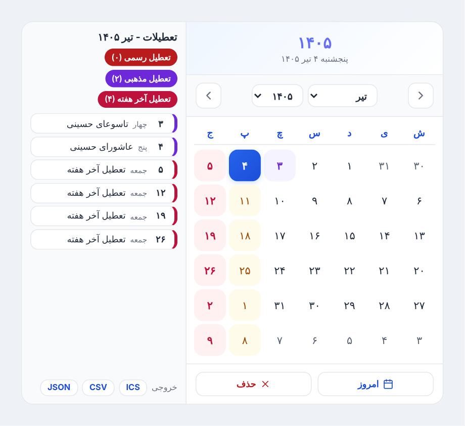

<div dir="rtl">

# ۴. تعطیلات

[فهرست مستندات](../README.md) · [English](../en/04-holidays.md) · **فارسی** · [→ حالت‌ها، بازه‌ها و میانبرها](03-modes-ranges-presets.md) · بعدی: [ساعت و رزرو وقت ←](05-time-and-booking.md)



iZiDatePicker می‌تواند تعطیلات را رنگی کند، با یک راهنما توضیح بدهد، ببندد، کنار تقویم فهرست کند و خروجی بدهد. تعطیلات سه نوع دارند و هر نوع رنگ خودش را:

| نوع | معنی | رنگ پیش‌فرض |
|---|---|---|
| `official` | تعطیلی رسمی | قرمز |
| `religious` | تعطیلی مذهبی / قمری | بنفش |
| `weekly` | تعطیلی هفتگی (جمعه‌ها در تقویم شمسی) | زرد / کهربایی |

## بدون هیچ کاری چه چیزی دارید؟

> **دربارهٔ داده صادق باشیم.** تعطیلات مذهبی با ماه تغییر می‌کنند و هر سال جابه‌جا می‌شوند؛ نمی‌شود آن‌ها را قابل‌اعتماد محاسبه کرد. iZiDatePicker آن‌ها را **حدس نمی‌زند**.

| تقویم | بدون پیکربندی |
|---|---|
| شمسی | **تعطیلات رسمیِ ثابتِ شمسی** (نوروز، ۱۲ و ۱۳ فروردین، ۱۴ و ۱۵ خرداد، ۲۲ بهمن، ۲۹ اسفند) هر سال، به‌علاوهٔ جمعه‌ها |
| میلادی | **هیچ تعطیلی‌ای نیست**؛ هر کشور فرق دارد و باید خودتان بدهید |

فهرست رسمی ایران برای **سال ۱۴۰۵** (با روزهای مذهبی) به‌صورت یک فایل جدا همراه کتابخانه است: `data/holidays/bundle.js`. این تنها سالی است که تأیید شده است. این‌طور بارگذاری‌اش کنید:

```html
<script src="izi-datepicker.min.js"></script>
<script src="data/holidays/bundle.js"></script>   <!-- iZiHolidays را تعریف می‌کند -->
<script>new iZiDatePicker('#date', { holidays: { data: iZiHolidays } });</script>
```

## تعطیلات خودتان را بدهید

### الف) یک فهرست کوچک داخل صفحه

<!-- test -->
```js
new iZiDatePicker('#date', {
  holidays: {
    data: {
      1406: [                                              // keyed by Jalali year
        { jm: 1, jd: 1, title: 'Nowruz', type: 'official' },
        { jm: 4, jd: 10, title: 'A religious day', type: 'religious' }
      ]
    }
  }
});
```

برای تقویم **میلادی** روزهایی را که هر سال تکرار می‌شوند با `fixed` بدهید:

<!-- test -->
```js
new iZiDatePicker('#range', {
  calendar: 'gregorian', locale: 'en',
  holidays: { fixed: [{ m: 1, d: 1, title: "New Year's Day" }, { m: 12, d: 25, title: 'Christmas Day' }] }
});
```

### ب) از فایل یا API بگیرید

<!-- test -->
```js
new iZiDatePicker('#date', {
  holidays: {
    sources: [
      { type: 'url', url: '/holidays/{year}.json' },          // {year} = the year being shown
      { type: 'api', url: 'https://api.example.com/holidays', params: { year: '{year}' },
        headers: { Authorization: 'Bearer MY_TOKEN' },
        path: 'result.items',                                   // where the array is in the response
        fields: { date: 'day', title: 'name', type: 'kind' },   // map YOUR field names
        typeMap: { rel: 'religious', gov: 'official' } },       // translate YOUR type words
      { type: 'url', url: '/calendar/{year}.ics', format: 'ics' }   // an iCalendar file
    ],
    cache: 'storage'            // remember the answers in localStorage
  }
});
```

سال‌ها **فقط وقتی کاربر آن‌ها را ببیند** و در پس‌زمینه بارگذاری می‌شوند. تا رسیدن داده، تقویم عادی کار می‌کند و بعد از رسیدن، تعطیلات رنگی می‌شوند. اگر یک منبع خطا بدهد، تقویم با آنچه دارد به کارش ادامه می‌دهد و رویداد `holidaysError` را می‌فرستد.

همهٔ نوع منبع‌ها:

| `type` | کاربرد |
|---|---|
| `json` | داده‌ای که از قبل در صفحه دارید: `{ type: 'json', data: ... }` |
| `map` | یک شیء با کلید تاریخ: `{ '2026-12-25': 'Christmas Day' }` |
| `dom` | JSON داخل `<script type="application/json" id="h">` ← `{ type: 'dom', selector: '#h' }` |
| `url` / `api` | HTTP: `url`، `method`، `headers`، `params`، `body`، `timeoutMs`، `format: 'json' \| 'ics' \| 'csv'` |
| `provider` | تابع async خودتان: `{ type: 'provider', fn: async year => [...] }` |
| `pack` | بستهٔ داده با نسخه (پایین‌تر) |

گزینه‌های مفید روی هر منبع: `name`، `years` / `from` / `to` (محدود کردن به چند سال)، `path`، `fields`، `typeMap`، `transform`. با `merge: 'all'` چند منبع را ترکیب کنید، به‌جای «اولین منبعی که داده دارد برنده است».

هر ردیف تعطیلی می‌تواند این شکل‌ها را داشته باشد:

```js
{ jm: 1, jd: 1, title: 'Nowruz', type: 'official' }     // ماه + روز در تقویم خود picker
{ date: '2026-12-25', title: 'Christmas Day' }           // تاریخ میلادی ISO
{ shamsiDate: '1405/01/01', title: '...' }               // متن تاریخ شمسی
```

### ج) بستهٔ داده (برای چند سال پیشنهاد می‌شود)

بسته یک پوشه است: `manifest.json` (کدام سال‌ها هست، با یک هش) به‌علاوهٔ یک فایل برای هر سال.

<!-- test -->
```js
new iZiDatePicker('#date', {
  holidays: { sources: [{ type: 'pack', base: '/holidays/' }], cache: 'storage' }
});
```

* سالی که در manifest نباشد **خطا نیست**؛ تقویم همان لایهٔ داخلی خودش را به کار می‌برد.
* سال‌های کش‌شده **یک‌بار در هر نشست** با manifest مقایسه می‌شوند و فقط وقتی هش عوض شده باشد دوباره بارگیری می‌شوند (اول آفلاین، همیشه تازه).
* بسته‌ها را با ابزارهای پوشهٔ [`tools/`](../../tools) بسازید و اعتبارسنجی کنید: `node tools/build-holidays.mjs` هر فایل سال را بررسی می‌کند (تاریخ‌ها باید با هم بخوانند و کپیِ سال قبل رد می‌شود) و `node tools/update-holidays.mjs --url "https://.../{year}" --years 1405-1410 --check` دانلود و مقایسه می‌کند؛ اگر چیزی بالادست عوض شده باشد با کد ۲ خارج می‌شود. workflow هفتگی مخزن این کار را برایتان می‌کند و یک pull request باز می‌کند.

## چه چیزی رنگی یا بسته شود

<!-- test -->
```js
new iZiDatePicker('#date', {
  highlightHolidays: true,        // colour them (default)
  highlightWeekend: true,
  tooltip: true,                  // hover to see the holiday name
  disableHolidays: ['official'],  // true = all types, or a list of types
  weeklyHolidays: ['friday'],     // which weekdays are the weekly day off
  holidays: false                 // turn the whole holiday system off
});
```

## پنل فهرست تعطیلات


<!-- test -->
```js
new iZiDatePicker('#date', {
  holidayList: {
    position: 'side',                  // 'side' or 'bottom'
    listScope: 'year',                 // 'view' = the shown month(s) (default), 'year' = the whole year, grouped by month
    types: ['official', 'religious'],  // which types start switched on
    export: ['ics', 'csv', 'json'],    // download buttons
    onClick: 'locate'                  // 'locate' or 'select'
  }
});
```

* **چیپ‌های فیلتر** یک نوع را روشن یا خاموش می‌کنند. هم فهرست را عوض می‌کنند **و** هم رنگ‌های داخل تقویم را.
* روی یک مورد **نگه دارید** (hover) تا روزش در تقویم قاب خط‌چین بگیرد.
* روی یک مورد **کلیک** کنید تا تقویم به همان روز برود (اگر لازم باشد ماه را عوض می‌کند). روز یک قاب ممتد با یک پالس کوتاه می‌گیرد و صفحه‌خوان نامش را می‌خواند. `onClick: 'select'` روز را انتخاب هم می‌کند.

## خروجی گرفتن از تعطیلات

<!-- test -->
```js
const p = new iZiDatePicker('#date', { holidays: { data: { 1406: [{ jm: 1, jd: 1, title: 'Nowruz' }] } } });
p.exportHolidays({ year: 1406, format: 'ics' }).then(text => console.log(text.split('\r\n')[0])); // BEGIN:VCALENDAR
p.listHolidays({ year: 1406 }).then(list => console.log(list.length, list[0].date, list[0].title));
p.downloadHolidays({ year: 1406, format: 'csv', filename: 'holidays.csv' });   // browser download
```

`format` می‌تواند `'ics'`، `'csv'`، `'json'` (متن) یا `'object'` (یک آرایهٔ ساده) باشد. این متدها صبر می‌کنند تا منبع‌های تنبل بارگذاری شوند.

## رویدادها

<!-- test -->
```js
new iZiDatePicker('#date', {
  onHolidaysLoaded: ({ year, source }) => console.log('loaded', year, source),
  onHolidaysError: ({ year, error }) => console.warn('could not load', year, error)
});
```

بعدی: [ساعت و رزرو وقت ←](05-time-and-booking.md)

</div>
