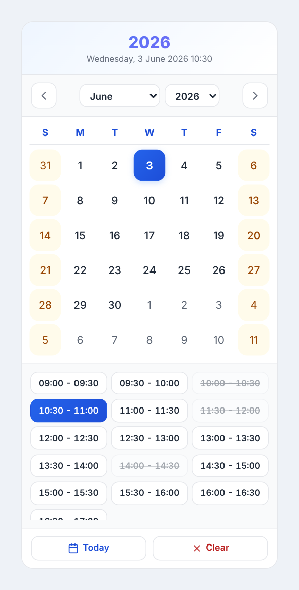
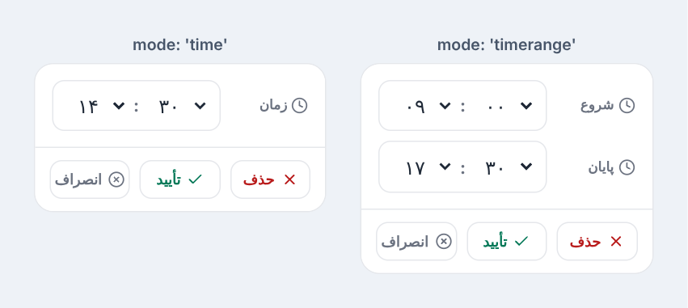

<div dir="rtl">

# ۵. ساعت و رزرو وقت

[فهرست مستندات](../README.md) · [English](../en/05-time-and-booking.md) · **فارسی** · [→ تعطیلات](04-holidays.md) · بعدی: [مقایسهٔ دو بازه ←](06-compare-ranges.md)



## تاریخ **و** ساعت

<!-- test -->
```js
new iZiDatePicker('#date', {
  timePicker: true,
  timeFormat: '24h',     // or '12h' (with AM/PM)
  timeStep: 5,           // minute steps: 1, 5, 10, 15, 30...
  showSeconds: false,
  minTime: '08:00',      // earliest / latest allowed time
  maxTime: '20:00',
  defaultTime: '09:00'   // the time used before the user touches the selectors
});
```

وقتی انتخاب‌گر ساعت روشن است، تقویم منتظر می‌ماند تا کاربر **تأیید** را بزند (`confirm: 'auto'`). با `confirm: false` بلافاصله ثبت می‌شود و با `confirm: true` همیشه تأیید می‌خواهد.

برای بازه همراه با ساعت، `mode: 'range'` را با `timePicker: true` بگذارید، و برای ساعتِ پایان `defaultEndTime` را.

## فقط ساعت (بدون تقویم)



<!-- test -->
```js
new iZiDatePicker('#time', { mode: 'time', timeFormat: '24h' });                 // "14:30"
new iZiDatePicker('#booking', { mode: 'timerange', timeFormat: '24h' });         // "09:00 - 17:30"
```

کاربر می‌تواند `14:30` یا `2:30 PM` را هم **تایپ** کند. در بازهٔ ساعتی، پایان هرگز قبل از شروع نمی‌شود.

<!-- test -->
```js
const t = new iZiDatePicker('#start', { mode: 'timerange', value: ['09:00', '17:30'], timeFormat: '24h' });
t.getValue('time');   // { start: '09:00', end: '17:30' }
```

برای `mode: 'time'` مقدار `getValue('time')` به شکل `'14:30'` است.

## زمان‌های رزرو (slot)

یک شبکه از ساعت‌ها (مثل صفحهٔ نوبت‌دهی پزشک): کاربر اول **تاریخ** و بعد **زمان** را انتخاب می‌کند.

<!-- test -->
```js
const booking = new iZiDatePicker('#booking', {
  calendar: 'gregorian', locale: 'en', timeFormat: '24h',
  timeSlots: {
    step: 30,                 // a slot starts every 30 minutes
    duration: 30,             // and lasts 30 minutes (0 = just a time, no end)
    min: '09:00',             // first slot
    max: '17:00',             // the last slot ends by this time
    columns: 3,               // buttons per row
    showEnd: true,            // label "09:00 - 09:30"
    disabled: (date, time) => date.day % 2 === 0 && time === '11:00'   // true = already taken
  },
  onSelect: (date, text) => console.log(text)       // "2026-06-03 10:30 - 11:00"
});
```

* تا وقتی تاریخ انتخاب نشده، زمان‌ها غیرفعال‌اند و یک راهنما دلیلش را می‌گوید.
* `disabled` می‌تواند یک **تابع** `(date, 'HH:mm') => boolean` یا یک **فهرست** ساده از زمان‌های پُر باشد: `disabled: ['10:00', '11:30']`.
* ساعت پایان از `duration` محاسبه می‌شود. با `booking.getRange()` یا از رویداد `select` (`payload.end`) بخوانیدش:

<!-- test -->
```js
const b = new iZiDatePicker('#end', { calendar: 'gregorian', locale: 'en', timeSlots: {} });
b.on('select', ({ value, end, formatted }) => console.log(value.hour, end.hour, formatted));
```

### زمان‌های پُر از سرور

زمان‌های پُر معمولاً از سرور می‌آیند. بگیریدشان و بعد گزینه‌ها را به‌روز کنید:

<!-- test -->
```js
const picker = new iZiDatePicker('#date', { calendar: 'gregorian', locale: 'en', timeSlots: { step: 60 } });
picker.on('select', async ({ value }) => {
  const res = await fetch('/api/taken?date=' + picker.getValue('iso'));    // e.g. ["10:00","15:00"]
  const taken = await res.json();
  picker.setOptions({ timeSlots: { step: 60, disabled: taken } });
});
```

> زمان‌بندی با `mode: 'single'` کار می‌کند. زمان‌ها رشته‌های ساده‌ی `HH:mm` هستند؛ منطقهٔ زمانی کار سرور شماست.

بعدی: [مقایسهٔ دو بازه ←](06-compare-ranges.md)

</div>
