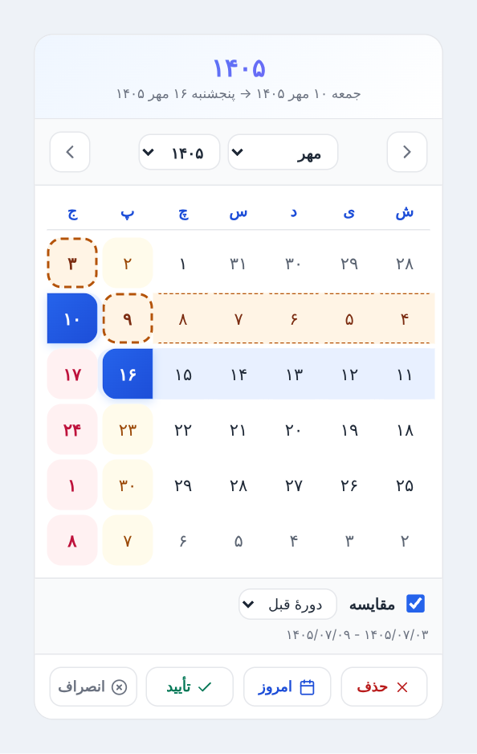

<div dir="rtl">

# ۶. مقایسهٔ دو بازه

[فهرست مستندات](../README.md) · [English](../en/06-compare-ranges.md) · **فارسی** · [→ ساعت و رزرو وقت](05-time-and-booking.md) · بعدی: [ظاهر، تم و موبایل ←](07-styling-and-themes.md)



داشبوردها اغلب «این ماه **در برابر** ماه قبل» را نشان می‌دهند. با یک گزینه روشنش کنید:

<!-- test -->
```js
new iZiDatePicker('#range', { mode: 'range', compare: true });
```

یک ردیف **مقایسه** زیر تقویم ظاهر می‌شود. تیکش را بزنید، نوع مقایسه را انتخاب کنید، بازهٔ خود را بردارید و **تأیید** را بزنید. بازهٔ مقایسه با قاب خط‌چین کهربایی کشیده می‌شود تا هرگز با بازهٔ اصلی اشتباه نشود.

## روش‌های مقایسه

| `mode` | بازهٔ مقایسه ... است |
|---|---|
| `'previousPeriod'` | همان تعداد روز، **بلافاصله قبل** از بازهٔ شما |
| `'previousYear'` | همان تاریخ‌ها، یک سال قبل (روز کبیسه هم درست حساب می‌شود) |
| `'custom'` | هر بازه‌ای که خودتان انتخاب کنید (روی **بازهٔ مقایسه** کلیک کنید، بعد دو روز) |

<!-- test -->
```js
new iZiDatePicker('#range', {
  mode: 'range',
  compare: {
    modes: ['previousPeriod', 'previousYear', 'custom'],  // which choices to offer
    mode: 'previousPeriod',                               // the starting choice
    enabled: false,                                       // start ticked or not
    separator: ' vs '                                     // text between the two ranges
  }
});
```

با `mode: 'week'` هم کار می‌کند و با میانبرها هم ترکیب می‌شود: روی «این ماه» کلیک کنید تا ماه قبل خودکار مقایسه شود.

## نتیجه را بخوانید

<!-- test -->
```js
const p = new iZiDatePicker('#range', {
  mode: 'range', compare: { enabled: true }, value: ['1405/07/10', '1405/07/16'],
  onRangeSelect: (start, end, text) => console.log(text)     // "1405/07/10 - 1405/07/16 vs 1405/07/03 - 1405/07/09"
});
p.on('rangeSelect', ({ start, end, compare }) => {
  // compare is null when the checkbox is off, otherwise { start, end } (date objects)
  console.log(start.day, end.day, compare && compare.start.day);
});
p.getCompare();                  // { start, end } or null
p.getValue('jalali');            // { start: '1405/07/10', end: '1405/07/16', compare: { start: '1405/07/03', end: '1405/07/09' } }
p.getValue();                    // the same, as text: "1405/07/10 - 1405/07/16 vs 1405/07/03 - 1405/07/09"
```

می‌توانید با متن یا شیء هم **مقدار بدهید**:

<!-- test -->
```js
const q = new iZiDatePicker('#range', { mode: 'range', compare: true });
q.setValue('1405/07/10 - 1405/07/16 vs 1405/05/01 - 1405/05/07');
q.setValue({ start: '1405/08/01', end: '1405/08/10', compare: { start: '1405/06/01', end: '1405/06/10' } });
```

> مقایسه‌ای که از سال‌های پشتیبانی‌شده بیرون بیفتد بی‌سروصدا کنار گذاشته می‌شود (بدون خطا). وقتی گزینهٔ compare روشن است، تقویم منتظر **تأیید** می‌ماند تا کاربر بتواند بعد از انتخاب تاریخ‌ها مقایسه را تنظیم کند.

بعدی: [ظاهر، تم و موبایل ←](07-styling-and-themes.md)

</div>
