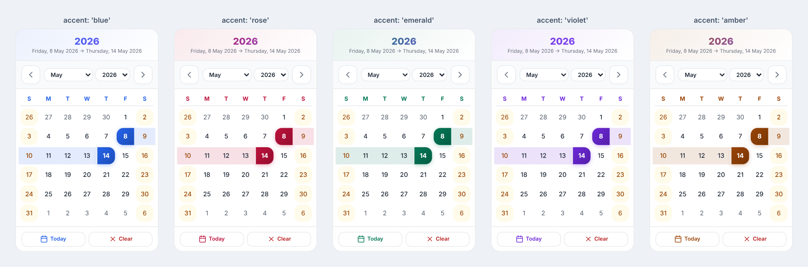
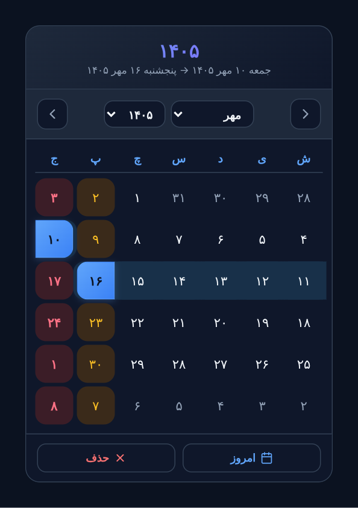
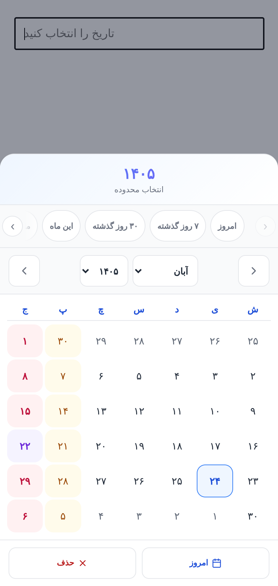

<div dir="rtl">

# ۷. ظاهر، تم و موبایل

[فهرست مستندات](../README.md) · [English](../en/07-styling-and-themes.md) · **فارسی** · [→ مقایسهٔ دو بازه](06-compare-ranges.md) · بعدی: [فریم‌ورک‌ها و موارد پیشرفته ←](08-frameworks-and-advanced.md)



## اندازه

<!-- test -->
```js
new iZiDatePicker('#date', { size: 'lg' });                 // xs 260px | sm 300 | md 340 (default) | lg 400 | xl 480 | fluid (100%)
new iZiDatePicker('#range', { width: 360, fontSize: 15 });  // exact width and base font size (everything scales with it)
```

## رنگ با یک خط

فقط **یک** رنگ بدهید؛ کل پالت (انتخاب، hover، نوار بازه، حلقهٔ فوکوس) از روی آن ساخته می‌شود:

<!-- test -->
```js
new iZiDatePicker('#date', { accent: 'rose' });      // blue ocean rose emerald violet amber slate
new iZiDatePicker('#range', { accent: '#0ea5e9' });  // or any CSS colour
```

## روشن، تاریک یا خودکار



<!-- test -->
```js
new iZiDatePicker('#date', { theme: 'dark' });   // 'light' | 'dark' | 'auto' (follows the device)
```

## کنترل دقیق‌تر

<!-- test -->
```js
new iZiDatePicker('#date', {
  cellShape: 'circle',          // 'rounded' | 'circle' | 'square'
  density: 'compact',           // 'compact' | 'normal' | 'comfortable'
  radius: 'xl',                 // 'none' | 'sm' | 'md' | 'lg' | 'xl' | a number in px
  shadow: 'lg',                 // 'none' | 'sm' | 'md' | 'lg'
  weekdayFormat: 'short',       // 'narrow' (1 letter) | 'short' | 'long'
  fontFamily: 'Vazirmatn, system-ui, sans-serif',
  showOutsideDays: false,       // blank cells instead of the neighbouring months' days
  showWeekdays: true,
  highlightToday: true,
  animation: 'fade',            // or 'none' (users who prefer reduced motion never get animation)
  colors: { primary: '#7c3aed', range: '#ede9fe', holiday: '#dc2626', weekend: '#b45309' }
});
```

کلیدهای `colors`: `primary background surface text textSecondary border hover range onPrimary faded today weekend weekendBg holiday holidayBg religious religiousBg weekly weeklyBg danger success`.

## CSS خودتان

نام همهٔ کلاس‌ها با `izi-` و همهٔ متغیرهای CSS با `--izi-` شروع می‌شود. سه راه برای سفارشی‌سازی دارید، از ساده‌ترین تا قدرتمندترین:

**۱. متغیرهای CSS** (همهٔ `--izi-*`: مثل `--izi-primary`، `--izi-radius`، `--izi-gap`، `--izi-font-size`)

```css
.my-picker { --izi-primary: #7c3aed; --izi-radius: 20px; }
```
<!-- test -->
```js
new iZiDatePicker('#date', { customClass: 'my-picker', cssVars: { '--izi-gap': '4px' } });
```

**۲. کلاس به بخش‌ها اضافه کنید**

<!-- test -->
```js
new iZiDatePicker('#date', { classNames: { root: 'shadow-xl', selected: 'my-selected', chip: 'my-chip', button: 'btn' } });
```

(بخش‌ها: `root preview header presets chip grid weekday cell today selected inRange disabled holiday weekend outside footer button`). با Tailwind یا Bootstrap به کار می‌آید.

**۳. بخش‌ها را خودتان بسازید**

<!-- test -->
```js
new iZiDatePicker('#date', {
  renderDay: cell => cell.holiday && cell.holiday.types.length ? cell.text + ' ★' : undefined,   // undefined = keep the default
  renderFooter: state => 'Showing ' + state.view.title                                         // a string is inserted as plain text
});
```

رشته‌ای که برمی‌گردانید به‌صورت **متن** درج می‌شود، هرگز HTML. وقتی markup لازم دارید یک عنصر DOM (یا fragment) برگردانید. در `renderHeader` روی دکمه‌های خودتان `data-act="prev"` / `"next"` بگذارید.

## دکمه‌ها و چیدمان

<!-- test -->
```js
new iZiDatePicker('#date', {
  showPreview: true,            // the big title with the chosen date at the top
  showMonthYearSelector: true,  // the month and year drop-downs
  showButtonIcons: true,
  footerButtons: ['today', 'clear'],   // 'auto' | 'none' | any of today / clear / confirm / cancel / your own { id, text, onClick }
  yearPicker: 'grid'            // a paged grid of years instead of a drop-down (nicer on phones)
});
```

## پنجره کجا باز شود

<!-- test -->
```js
new iZiDatePicker('#date', {
  appendTo: 'body',       // put the popup inside another element (for modals, scrolling boxes)
  position: 'auto',       // 'auto' | 'top' | 'bottom'
  zIndex: 10000,          // raise it above your own layers
  strategy: 'fixed',      // use 'absolute' inside transformed containers
  closeOnSelect: true, closeOnOutsideClick: true, openOn: 'click'   // 'click' | 'focus' | 'both'
});
```

پنجرهٔ بازشو هرگز از ارتفاع صفحه بلندتر نمی‌شود (به‌جای بریده شدن اسکرول می‌خورد) و اگر اندازه‌اش در حالت باز عوض شود خودش را دوباره جا می‌دهد.

## گوشی و تبلت



روی صفحه‌هایی تا عرض ۵۲۰ پیکسل، تقویم به‌صورت **برگهٔ پایین (bottom sheet)** باز می‌شود: هدف‌های لمسیِ بزرگ‌تر (۴۴ پیکسل)، با کشیدن به چپ و راست ماه عوض می‌شود، صفحهٔ پشت اسکرول نمی‌خورد و کیبورد صفحه بسته می‌ماند. کنترلش کنید:

<!-- test -->
```js
new iZiDatePicker('#date', {
  sheet: 'auto',            // 'auto' | true | false
  swipe: true,
  suppressKeyboard: 'auto', // don't pop the keyboard up when tapping the input
  lockScroll: true
});
```

## دسترس‌پذیری

* تقویم یک دیالوگ درست با یک جدولِ برچسب‌دار است؛ هر روز یک برچسب کامل برای صفحه‌خوان دارد (مثلاً «شنبه ۱ فروردین ۱۴۰۵، عید سعید فطر»).
* همه‌چیز با صفحه‌کلید کار می‌کند (ببینید [راهنمای ۳](03-modes-ranges-presets.md#صفحهکلید))؛ وقتی پنجره بسته شود فوکوس به کادر برمی‌گردد (`restoreFocus`).
* تغییرها از راه یک live region اعلام می‌شوند.
* رنگ‌ها در تم روشن و تاریک کنتراست **WCAG AA** دارند (با axe-core سنجیده شده).
* کسانی که حرکت کم را ترجیح می‌دهند هیچ انیمیشنی نمی‌بینند.

بعدی: [فریم‌ورک‌ها و موارد پیشرفته ←](08-frameworks-and-advanced.md)

</div>
